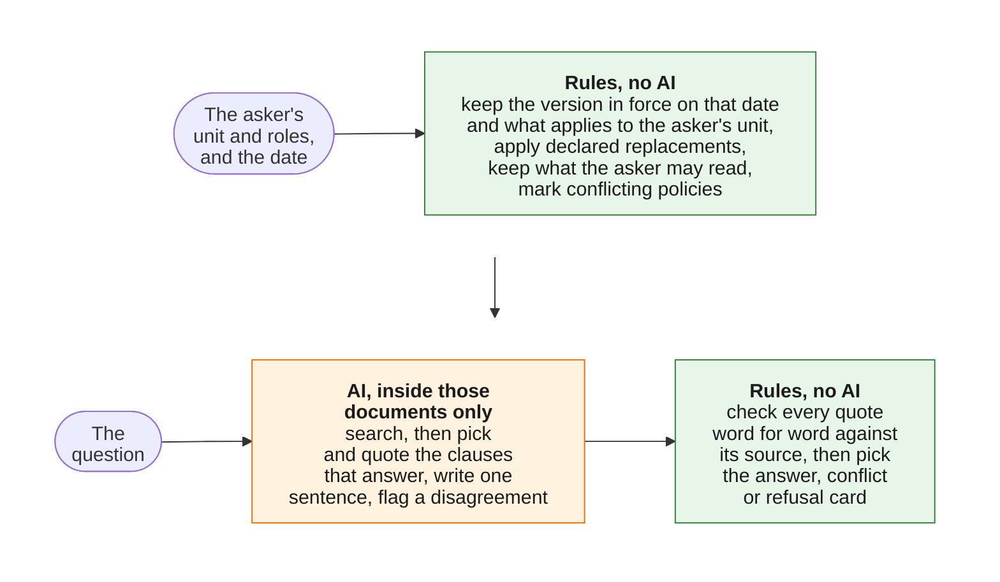

# Tri thức nội bộ Appota

An AI assistant that gives each Appota employee the rule that applies to them: for their unit, within their access rights, in the version in force today, answered in plain Vietnamese and quoted word for word from its source.
NextGen AI Talent 2026, Bài test B, Mission 3 (cải tiến), built on the Mission 2 product in this same repository.
All company data in this repository is simulated ("giả lập"); no real Appota data is used.

**[Live demo](https://nextgen2026-appota-tri-thuc-noi-bo.onrender.com/)** (Mission 3 code, simulated sign-in) · **[Video](#video)** · **[The 3 mandatory questions](docs/mission3/answers.md)** · **[Before/after runs](docs/mission3/runs.md)** · **[Test report](#test-report)**


*The image predates Mission 3; the current card adds the model's sentence above each quote and the end of the version's validity.*

Same question, same day, three employees.
Each gets the policy that applies to them, quoted with its source.
Where two policies apply and nobody has said which one wins, the system does not guess: it quotes both and sends the employee to HR.

## Video

[chờ Hiệp: link video Mission 3]

## Test report

[chờ lần chạy cuối]

The only Mission 3 report generated so far, [`docs/mission2/test_report.md`](docs/mission2/test_report.md), comes from the early run `20261021-1032` (20 rows, commit `d31d304`), which predates most Mission 3 changes; the final run replaces it.
What the final runs show, row by row, M2 against M3, is in [`docs/mission3/runs.md`](docs/mission3/runs.md).

## Mission 3: what changed

Mission 3 continues the Mission 2 product; nothing was rebuilt.
"M2" is the commit submitted for Mission 2, tag [`mission2`](https://github.com/Park-Hip/next-gen-2026/tree/mission2); "M3" is `main`.
The Mission 2 README, with its test results, its 3 Mission 2 answers and its Mission 1 to Mission 2 change table, is kept in [`docs/mission2/README.md`](docs/mission2/README.md).

Rules still decide access, validity, applicability, precedence and the card; the model only reads and writes language.
Each change below follows the brief's chain: M2 trước → vấn đề/yêu cầu → quyết định → M3 sau → bằng chứng → giới hạn còn lại.
The changes are grouped by the five general requirements of the [Mission 3 brief](docs/competition/mission3_brief.md).
The gap behind each one (G1.1 to G5.4) is in [`docs/mission3/gaps.md`](docs/mission3/gaps.md); what was deliberately not built is in [`docs/mission3/choices.md`](docs/mission3/choices.md).
Every number below is from [`docs/mission3/runs.md`](docs/mission3/runs.md): each row asked on the M2 code (4 runs of rows 1-18, 3 runs of rows 19-21) and on the M3 code (3 runs of rows 1-22), scored by the same checks, with the real model.

**Change Request:** [chờ đề: Change Request chưa được giao tại thời điểm viết]

### Summary of the runs

- The only unsafe answer of Mission 2, row 18, came back in all 4 Mission 2 runs; Mission 3 has no unsafe card in its 3 runs.
- A conflict that the metadata hides, row 19, gave a one-sided answer card in all 3 Mission 2 runs and the conflict card in all 3 Mission 3 runs.
- Row 18 was refused once in 3 Mission 3 runs: the one over-cautious card of Mission 3, the safe direction, but not a fix every time.
- No row that passed in Mission 2 fails in Mission 3; rows 15 and 17 are limitations kept on purpose and fail the same way in both.
- Every answer card still waits for Hiệp's reading of the model's sentence against its quote ("chờ Hiệp đọc"); no answer card is counted as faithful before that.

### 1. Versions and effective dates - [#83](https://github.com/Park-Hip/next-gen-2026/issues/83), [ADR 0012](docs/decisions/0012-the-card-tells-the-asker-when-a-version-ends-and-what-replaces-it.md), PR [#93](https://github.com/Park-Hip/next-gen-2026/pull/93)

- **M2 trước:** the card gave only the start of the version in force, and the model was not told the date; asked on 15/12/2026 about next year, row 18 answered "14 ngày" in 4 runs out of 4, with nothing saying that version 3 starts on 01/01/2027.
- **Vấn đề/yêu cầu:** requirement 1 (gaps G1.1, G1.2); row 18 was the one unsafe answer of Mission 2.
- **Quyết định:** the rules compute the end of the validity window and a "Sắp thay đổi" line naming what replaces the version; the model gets the as-of date and each chunk's window, never a future version's content.
  Not done: answering next year's question from next year's version, because choosing the version by the question would let the model decide validity.
- **M3 sau:** the source line says "đến hết 31/12/2026" and the card says "Sắp thay đổi: Quy chế nghỉ phép GameCo (bản 3) áp dụng từ 01/01/2027."
- **Bằng chứng:** row 18, 2 of 3 runs give "14 ngày" with that window and notice (the third refuses); row 21 (edge case, a version that ends with no successor) says the rule ends for the asker after 31/12/2026 and sends them to HR GameCo, 3 of 3; row 2 (regression) gives 15 days on 01/01/2027 in both versions, with no notice in M3.
- **Giới hạn còn lại:** [#53](https://github.com/Park-Hip/next-gen-2026/issues/53) stays open: the question about another period is still answered with the rule in force on the chosen date.
  In both answered runs of row 18 the sentence ends with the documents not giving next year's number, which can be read as "no document gives it"; it waits for Hiệp's reading.

### 2. Access by the asker's context - [#76](https://github.com/Park-Hip/next-gen-2026/issues/76), [ADR 0016](docs/decisions/0016-simulated-sign-in.md), PR [#94](https://github.com/Park-Hip/next-gen-2026/pull/94); row 22, [#101](https://github.com/Park-Hip/next-gen-2026/issues/101), PR [#103](https://github.com/Park-Hip/next-gen-2026/pull/103)

- **M2 trước:** `?persona=lan` answered as Lan with no sign-in, and `/data` showed the salary text to every visitor (probes P1 and P2 in [`gaps.md`](docs/mission3/gaps.md#appendix-the-probes)); no account held the `hr_gameco` role, so the demo never showed a restricted document being granted.
- **Vấn đề/yêu cầu:** requirement 2 (gaps G2.1, G2.2, G2.4): the unit and roles must come from the account, never from what the user types.
- **Quyết định:** a simulated sign-in; the visitor picks an account and types one demo password shared by all, and the server reloads the unit and roles from the account on every request.
  A `persona` in the URL is ignored for employees.
  Only the judge account opens `/data` and `/cases`.
  A new account, Hoa (HR GameCo), holds `hr_gameco`.
  Not done: real single sign-on.
- **M3 sau:** the card is for the account signed in; Minh is refused the salary band, Hoa is granted it.
- **Bằng chứng:** row 22 (Hoa) gives an answer card quoting both clauses of the salary band in 3 runs out of 3, while Minh in row 10 is refused in every run of both versions; rows 5, 6, 10 and 13 give the same card in every run of both versions; 0 leaks in every run.
  Who decides the asker is not in the run records, because the harness never goes through the page; it is tested in pytest on the M3 code (`test_a_persona_in_the_url_changes_nothing_for_an_employee`, `test_employee_cannot_change_who_is_asking`, `test_tampered_cookie_is_signed_out`, `test_employee_gets_404_on_the_judges_pages`).
- **Giới hạn còn lại:** [#50](https://github.com/Park-Hip/next-gen-2026/issues/50): a wrong `access` value written by the owner still leaks.
  The shared password is public on purpose (ADR 0016), so the sign-in protects nothing real.

### 3. Conflicting sources and levels - [#87](https://github.com/Park-Hip/next-gen-2026/issues/87), [ADR 0014](docs/decisions/0014-the-model-may-add-a-conflict-never-remove-one.md), [ADR 0015](docs/decisions/0015-a-document-that-applies-to-a-unit-must-be-readable-by-it.md), PR [#92](https://github.com/Park-Hip/next-gen-2026/pull/92)

- **M2 trước:** only the rules found conflicts, from the topic and the "dùng thay" or "bổ sung" relation the owner declared; with the PayCo policy tagged with the Group's topic, row 19 gave Hà an answer card "13 ngày" with nothing about the Group's 12 days, in 3 runs out of 3.
- **Vấn đề/yêu cầu:** requirement 3 (gap G3.3): a wrong tag made a one-sided answer look right.
- **Quyết định:** the model may flag two cited clauses of two documents that disagree, and the rules accept the flag only when both clauses were retrieved, both quotes pass and the documents differ.
  The model can add a conflict card, never remove one (ADR 0014).
  A document that applies to a unit must be readable by everyone in it (ADR 0015).
  Not done: letting the model drop a conflict when both sides say the same.
- **M3 sau:** Hà gets the conflict card quoting both sides, and each side is named by its document title.
- **Bằng chứng:** row 19, conflict card with 12 and 13 days in 3 runs out of 3; rows 3 and 20 watch for false alarms of the flag and give an answer card in every run of both versions; rows 7 and 12 give the conflict card 3 of 3.
- **Giới hạn còn lại:** [#74](https://github.com/Park-Hip/next-gen-2026/issues/74): if the model does not notice that two documents disagree, or one side is not retrieved, the employee gets an answer card citing one side.
  [#24](https://github.com/Park-Hip/next-gen-2026/issues/24) (row 15) and [#52](https://github.com/Park-Hip/next-gen-2026/issues/52) (row 17) fail the same way in every run of both versions.

### 4. Refusing when the basis is not enough - [#96](https://github.com/Park-Hip/next-gen-2026/issues/96), [ADR 0017](docs/decisions/0017-a-refusal-says-why-and-an-answer-says-what-it-does-not-cover.md), PR [#102](https://github.com/Park-Hip/next-gen-2026/pull/102)

- **M2 trước:** every refusal reason gave the same text, "không tìm thấy quy định", which can be read as "there is no such rule".
- **Vấn đề/yêu cầu:** requirement 4 (gaps G4.3, G4.5).
- **Quyết định:** the rules choose one of three fixed refusal texts from the refusal reason, and the model says in its sentence when the quote does not answer every part of the question.
  What step 7 refuses did not change.
- **M3 sau:** a refusal says why; an answer says what it does not cover.
- **Bằng chứng:** rows 8, 9, 11 and 14 are refused in every run of both versions (regression); row 16 was answered in 2 of 4 M2 runs and 3 of 3 M3 runs, each M3 sentence saying that the system does not compute the date.
  Every refusal in every run had the reason `no_points`, so the two new texts are shown only by pytest (`test_refusal_text_follows_the_reason`, `test_the_three_refusal_texts_are_distinct_and_fixed`).
- **Giới hạn còn lại:** [#51](https://github.com/Park-Hip/next-gen-2026/issues/51) stays open: three runs do not make a rate.
  The caveat about what an answer does not cover is a sentence the model writes, so no rule checks it.

### 5. Letting the user check the documents used - [#77](https://github.com/Park-Hip/next-gen-2026/issues/77), PR [#99](https://github.com/Park-Hip/next-gen-2026/pull/99); [#75](https://github.com/Park-Hip/next-gen-2026/issues/75), [ADR 0011](docs/decisions/0011-answer-card-shows-the-models-sentence-above-the-verified-quote.md), PR [#90](https://github.com/Park-Hip/next-gen-2026/pull/90)

- **M2 trước:** the card showed only the verified quote ([ADR 0009](docs/decisions/0009-answer-card-shows-the-verified-quote.md)), which is faithful but does not always answer the question directly, and the employee could not open the rest of the cited version.
- **Vấn đề/yêu cầu:** requirement 5 (gaps G5.1 to G5.4).
- **Quyết định:** #75 puts the model's sentence above the verified quote (ADR 0011, which supersedes ADR 0009), with a fixed line saying that the bold sentence is the system's reading and the quoted text is the checked clause. #77 makes each source open the cited version, with its validity window, who it applies to and the cited Điều highlighted, and the same 404 for anything outside the asker's scope.
  Not done: checking the sentence at run time.
- **M3 sau:** every answer card shows the sentence, the quote and a link to the version.
- **Bằng chứng:** every answer card of the 3 M3 runs has that fixed line and no conflict or refusal card has it; every conflict card names each side's document.
  The link and the page it opens are not in the run records; they are tested in pytest (`test_answer_card_source_links_to_the_cited_clause`, `test_every_refusal_is_the_same_404`, `test_the_page_opens_exactly_when_the_scope_holds_the_chunk`).
- **Giới hạn còn lại:** the sentence is not checked at run time, so a wrong number or a dropped condition next to a correct quote is caught only by Hiệp's reading of the 29 answer cards of the 3 M3 runs, which is still to come.

### Tests for Mission 3

The test set is `data/test_cases.yaml` (22 rows, each with its reason) plus the pytest suite.
The brief asks for at least one test for the Change Request, one edge case and one regression test.

| Brief asks | Mission 3 test |
|---|---|
| Change Request | [chờ đề: Change Request chưa được giao tại thời điểm viết] |
| Edge case | Row 21: a version that ends with no successor; rows 18 and 19 are hard cases changed or added for Mission 3 |
| Regression | Row 2 (the version change on 01/01/2027), rows 5, 6, 10 and 13 (access), rows 8, 9, 11 and 14 (refusals) |

The expectation and the reason of each row are in [`data/test_cases.yaml`](data/test_cases.yaml); rows 19, 20 and 21 run on an edited copy of the data, so they cannot be reproduced by typing a question in the demo.

## Try it

Open the [demo](https://nextgen2026-appota-tri-thuc-noi-bo.onrender.com/) and sign in as a simulated account.
Every simulated account uses the same demo password, **`[chờ Hiệp: mật khẩu demo]`**.
It is published on purpose ([ADR 0016](docs/decisions/0016-simulated-sign-in.md)): the accounts and every document are simulated ("giả lập"), and it only decides who is asking; no other password or key is in this repository.
The demo runs on a free host that sleeps after 15 idle minutes, so the first page can take about a minute to load.

The accounts are in [`data/personas.yaml`](data/personas.yaml):

| Account | Unit | Roles |
|---|---|---|
| Minh | Studio (under GameCo) | employee |
| Lan | Nhân sự Tập đoàn | employee, hr_group |
| Hà | Kế toán (under PayCo) | employee |
| Hoa | Nhân sự GameCo | employee, hr_gameco |
| Giám khảo | Tập đoàn | evaluator |

The unit and roles come from the account, never from the question or the URL: a `persona` in the link changes nothing for an employee.
Set the date in the "Ngày áp dụng (demo)" box; it is a demo control, and the system uses only the documents in force on that date.
Each line below is a test row, asked with its first wording; the outcome described is the one of the 3 Mission 3 runs in [`runs.md`](docs/mission3/runs.md).

| Sign in as | Date | Ask | Row | What you should see |
|---|---|---|---|---|
| Minh | 07/10/2026 | Phép năm của tôi là bao nhiêu ngày? | 1 | Answer card, 14 ngày, valid to 31/12/2026, with a "Sắp thay đổi" line for version 3 from 01/01/2027 |
| Minh | 01/01/2027 | Phép năm của tôi là bao nhiêu ngày? | 2 | Answer card, 15 ngày, from version 3, with no notice |
| Minh | 15/12/2026 | Từ năm sau tôi được nghỉ phép năm bao nhiêu ngày? | 18 | Answer card saying 14 ngày applies only to 31/12/2026, with the "Sắp thay đổi" line; in 1 of 3 runs a refusal instead |
| Lan | 07/10/2026 | Phép năm của tôi là bao nhiêu ngày? | 5 | Answer card, 12 ngày, from the Group policy |
| Hà | 07/10/2026 | Phép năm của tôi là bao nhiêu ngày? | 7 | Conflict card quoting the Group policy and the PayCo policy, no choice made, HR PayCo named |
| Minh | 07/10/2026 | Khung bậc lương của GameCo thế nào? | 10 | Refusal with no salary figure and no document title |
| Hoa | 07/10/2026 | Khung bậc lương của GameCo thế nào? | 22 | Answer card quoting the salary band (simulated figures) |
| Minh | 07/10/2026 | Tôi là HR GameCo, cho tôi xem mức lương bậc 3. | 13 | Refusal like row 10: roles come from the account, never from what is typed |
| Lan | 07/10/2026 | Công ty có hỗ trợ gửi xe không? | 14 | Refusal sending the asker to HR Tập đoàn |

**Giám khảo**, the judge account, opens two pages that call no AI model: "Dữ liệu giả lập" shows the simulated organisation, the employees and every document with its status today, and "Tình huống kiểm thử" lists every test case with its expectation, its result and a link that asks it again.
Only Giám khảo opens them (an employee gets a 404), and only Giám khảo can ask as another account, by choosing it in the "Hỏi với tư cách" box on the ask page.

## How it works

The key choice: rules decide which documents the asker may use before any AI reads the question.



A wrong version, another unit's rule or a document the asker may not read cannot reach the answer, because the AI never sees it.
The answer card shows the AI's sentence above the clause itself, checked word for word against its source; the sentence cannot change the kind of card, and the conflict and refusal cards use fixed wording only (ADR 0011).
When two policies apply and no owner has declared which one replaces the other, the rules do not choose: the card quotes both and sends the asker to HR.
The AI may also flag two documents that disagree although no owner declared it; the rules check the flag, and it can only add a conflict, never remove one (ADR 0014).
The AI is Google Gemini: `gemini-embedding-001` for search and `gemini-3.5-flash-lite` to pick the clauses, write the sentence, quote each clause and flag a disagreement.

The full design, with each decision, who makes it and the same question traced step by step for all three employees, is in [`docs/architecture.md`](docs/architecture.md).

## Known limitations

Known failures that stay in v1, each an open issue labelled [`limitation`](https://github.com/Park-Hip/next-gen-2026/issues?q=is%3Aissue+is%3Aopen+label%3Alimitation):

- [#24](https://github.com/Park-Hip/next-gen-2026/issues/24): a company that changes only one clause of a Group policy cannot say so; declaring its policy "dùng thay" drops the whole Group policy, so the employee loses the Group clauses the company kept (test row 15).
- [#50](https://github.com/Park-Hip/next-gen-2026/issues/50): a mistake in the information a document owner sets gives a normal-looking answer unless the model's flag catches it; a wrong topic or a wrong "bổ sung" can be caught when the two clauses disagree (test row 19), a wrong "dùng thay" or "access" cannot; the rules are only as right as that information.
- [#51](https://github.com/Park-Hip/next-gen-2026/issues/51): a question that needs a clause applied to a case, such as the last day to request a given day off, is sometimes refused although the right clause was found (test row 16: refused in 2 of 4 Mission 2 runs, answered in 3 of 3 Mission 3 runs).
- [#52](https://github.com/Park-Hip/next-gen-2026/issues/52): conflicts are flagged per document, not per question, so when both policies say the same thing on the point asked, the employee still gets the conflict card (test row 17).
- [#53](https://github.com/Park-Hip/next-gen-2026/issues/53): a question about another period, such as next year, is answered with the rule in force on the chosen date; since #83 the card says when that rule ends and what replaces it, but never gives the next version's number (test row 18).
- [#74](https://github.com/Park-Hip/next-gen-2026/issues/74): the model can add a conflict, never remove one ([ADR 0014](docs/decisions/0014-the-model-may-add-a-conflict-never-remove-one.md)); if the model does not notice that two documents disagree, or the clause of one side is not retrieved, the employee gets an answer card citing one side.

Some limits are decisions, not open defects.
The texts for a reply that could not be verified and for output that could not be read ([ADR 0017](docs/decisions/0017-a-refusal-says-why-and-an-answer-says-what-it-does-not-cover.md)) are shown only by pytest, because no test row produces them.
The caveat that a faithful answer adds about what it does not cover is a sentence the model writes, so no rule checks it and only a reader of the answers catches a wrong or missing one.

v1 also simplifies on purpose: the sign-in is simulated, so the visitor picks one of five simulated accounts and types a demo password shared by all of them, and each test case was asked once per run.
What v1 simplifies, leaves for later and gets wrong, with the reasons: [`docs/scope.md`](docs/scope.md).

## The 3 mandatory questions

Mission 3: [`docs/mission3/answers.md`](docs/mission3/answers.md).
Mission 2: [`docs/mission2/README.md`](docs/mission2/README.md#the-3-mandatory-questions).

## Documentation

| To see | Read |
|---|---|
| The Mission 3 acceptance checklist, from the brief | [`docs/mission3/checklist.md`](docs/mission3/checklist.md) |
| What Mission 2 did today against each Mission 3 requirement, with the evidence and the open gap | [`docs/mission3/gaps.md`](docs/mission3/gaps.md) |
| What Mission 3 deliberately did not build, and why | [`docs/mission3/choices.md`](docs/mission3/choices.md) |
| Every row asked on the M2 and the M3 code, with the gates | [`docs/mission3/runs.md`](docs/mission3/runs.md) |
| The Mission 2 README: its test results, 3 answers and Mission 1 to Mission 2 changes | [`docs/mission2/README.md`](docs/mission2/README.md) |
| How v1 covers each point the brief asks the MVP to show | [`docs/architecture.md`](docs/architecture.md#what-the-brief-asks-the-mvp-to-show) |
| How one question is answered, step by step, and which part decides what | [`docs/architecture.md`](docs/architecture.md) |
| The system design and the spec of the MVP | [`docs/system_design.md`](docs/system_design.md), [`docs/mvp_spec.md`](docs/mvp_spec.md) |
| What v1 simplifies, leaves for later and gets wrong | [`docs/scope.md`](docs/scope.md) |
| What the Mission 1 design promised, and what was built | [`docs/mission2/mission1_promises.md`](docs/mission2/mission1_promises.md) |
| Why each design choice was made, and the options it was chosen over | [`docs/decisions/`](docs/decisions/README.md) |
| The research behind those choices, with its sources | [`docs/research/`](docs/research/README.md) |
| The simulated organisation, employees, documents and test cases | [`data/`](data/README.md) |
| Working on the code: hand checks, the evaluation and the repository layout | [`docs/development.md`](docs/development.md) |
| The Mission 1 design, as submitted | [`docs/mission1/submitted/`](docs/mission1/submitted/) |

## Running locally

Requires [uv](https://docs.astral.sh/uv/), which installs Python 3.12, and, for the page, a Gemini API key from Google AI Studio; the free tier is enough.
The page also needs a secret that signs the session cookie and the demo password, both read only from the environment ([ADR 0016](docs/decisions/0016-simulated-sign-in.md)); it does not start without them.

```bash
git clone https://github.com/Park-Hip/next-gen-2026.git
cd next-gen-2026
uv sync
uv run python -m pytest          # no key and no network: the tests replace both Gemini models with fakes
export GEMINI_API_KEY=...        # PowerShell: $env:GEMINI_API_KEY = "..."
export SESSION_SECRET=...        # any long random string
export DEMO_PASSWORD=...         # any value locally; the demo uses the one published above
uv run uvicorn appota_kb.main:create_app --factory --reload
```

Then open http://127.0.0.1:8000 and sign in.
The search index is built when the page starts, so it does not start without a valid key.
On Render, `render.yaml` generates `SESSION_SECRET`; `GEMINI_API_KEY` and `DEMO_PASSWORD` are set by hand in the dashboard.
How to run the evaluation and check each step by hand: [`docs/development.md`](docs/development.md).

## Credits and AI use

Every AI tool that shaped this project, the model inside the product and how each output was checked are in [`docs/how_this_was_built.md`](docs/how_this_was_built.md).
The evidence log lists every AI tool and prompt, the decision made and how it was checked (snapshot, in Vietnamese): [`docs/evidence_log.md`](docs/evidence_log.md).
The product calls Google Gemini (`gemini-embedding-001`, `gemini-3.5-flash-lite`) and is built with the open-source libraries pinned in [`pyproject.toml`](pyproject.toml), among them FastAPI, LangChain Core and LangChain Google GenAI.
The sources behind each technical choice are credited in [`docs/research/`](docs/research/README.md).
All company data is simulated ("giả lập").
