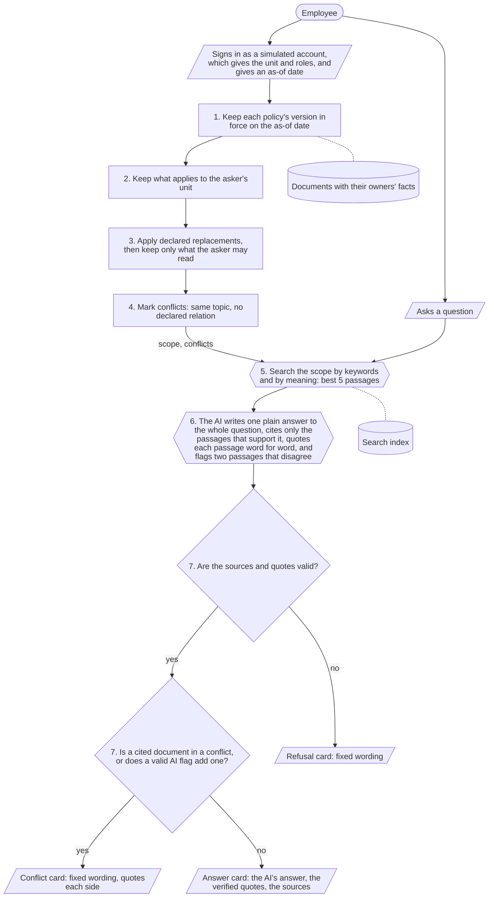
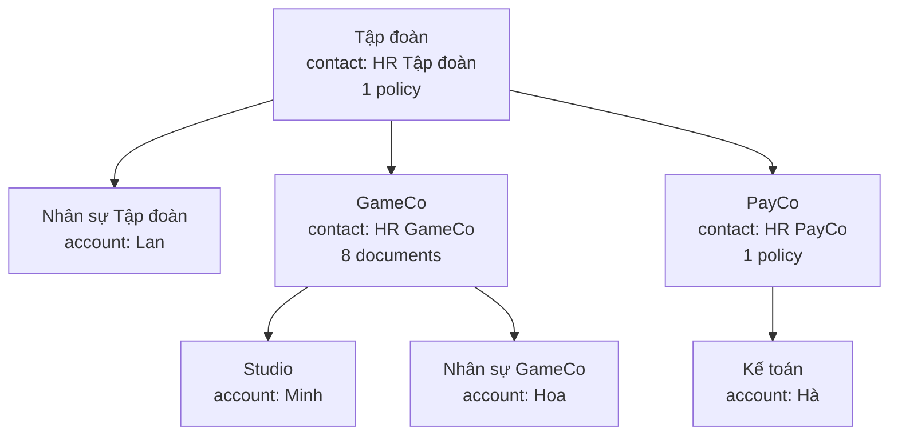

# Architecture

The product gives each employee the answer that fits their unit, their reading rights and the date they ask for, quoted from the company's own documents.
Its one design idea is that fixed rules decide which documents the AI may see and which of three cards the employee gets; the AI only reads and writes language.
This page follows one question from the employee's screen to the card, then says who decides what and what the AI can still get wrong.

Every unit, person, document and number on this page is simulated ("giả lập").
The [glossary](../README.md#glossary) explains the terms, [`scope.md`](scope.md) lists what the product simplifies, defers and gets wrong, and the [decisions index](decisions/README.md) lists each design choice since Mission 1.
Code names, settings and file paths are collected in [Technical detail](#technical-detail) at the end.

## The 7 steps

Minh works in Studio, a department of GameCo, and signs in with a simulated account.
On 07/10/2026 he asks "Phép năm của tôi là bao nhiêu ngày?" (how many days of annual leave do I get?).
The product answers in seven steps.
The first four use only who Minh is and the date; they never read his question.
Only step 5 does.

A hexagon is a step where an AI model works, a rectangle or a diamond is a step where fixed rules decide, a parallelogram is what the employee enters or sees, and a cylinder is a store of data.
The "scope" is the set of documents that this asker may read, that apply to their unit, and that are in force on the as-of date.
A "passage" is one numbered clause (Điều) of a document, or one line of a document that has no clauses.

**Before step 1.**
The server, not Minh, decides who is asking: his account gives his unit (Studio, which is part of GameCo, which is part of the Group) and his role (employee).
The as-of date is the date the question is asked for: today in real use, and chosen by the person in the demo.

**Step 1 - which versions are in force.**
GameCo's leave policy has four versions: v1 (13 days, from 01/01/2024), v2 (14 days, from 01/01/2026), v3 (15 days, from 01/01/2027) and a v4 draft (16 days).
On 07/10/2026 only v2 is in force: v1 has been replaced by v2, v3 has not started and a draft never counts.

**Step 2 - what applies to Minh's unit.**
A policy applies to its own unit and every unit below it.
Studio is below GameCo, so GameCo's documents apply to Minh; PayCo's leave policy does not.

**Step 3 - what replaces what, then what Minh may read.**
GameCo's v2 states that it is used instead of the Group leave policy (12 days), so the Group policy is dropped for Minh.
The GameCo salary bands can be read by GameCo HR only, so they are dropped too.
Reading rights are checked last on purpose, so that whether Minh may read a document never decides which policy applies [ADR 0010].
A document the asker may not read still replaces the policy it names, and the asker gets the refusal card instead of the replaced policy.

**Step 4 - conflicts.**
Two documents left in the scope on the same topic, with no statement from their owners that one adds to the other, are marked as a conflict.
Minh has none: the leave-request procedure declares that it adds to ("bổ sung") the leave policy.
His scope is now 4 documents and 11 passages: the leave policy v2, the leave-request procedure, the overtime rules and the travel expenses.
These four steps give the same scope for every question the same asker asks on the same date.

**Step 5 - search.**
Only now is the question used.
The product ranks Minh's 11 passages by keywords and by meaning and keeps the best 5.
A passage outside his scope is never ranked, and if one were returned the product would stop with an error.

**Step 6 - the AI reads and writes.**
The AI receives the 5 passages with their dates, Minh's unit, the date and the question.
It returns one plain answer to the whole question, the passages it cites, and a quote copied word for word for each.
It may also return nothing, or flag two passages that disagree.
In the 22/10/2026 run it cited GameCo's leave policy v2, Điều 2.

**Step 7 - the rules check the AI and pick the card.**
Every quote must have a source entry, the source must be one of the 5 passages, and the quote must appear word for word in the passage it cites.
If any check fails, the product refuses.
Otherwise a cited document that is in a conflict, or one that a valid AI flag pairs with another, gives the conflict card; if not, the answer card.
Minh gets the answer card; the AI's answer and quote are from the 22/10/2026 run, and the other lines are produced by the rules:

> Bạn đang hỏi với tư cách: nhân sự GameCo, Studio.
> Đoạn in đậm là câu trả lời của hệ thống; đoạn trong ngoặc kép là nguyên văn quy định đã được đối chiếu.
> **Nhân sự GameCo được nghỉ phép năm 14 ngày mỗi năm.**
> "Nhân sự GameCo được nghỉ phép năm 14 ngày mỗi năm."
> Nguồn: Quy chế nghỉ phép GameCo (bản 2), Điều 2, hiệu lực từ 01/01/2026 đến hết 31/12/2026. Hỏi thêm: HR GameCo.
> Sắp thay đổi: Quy chế nghỉ phép GameCo (bản 3) áp dụng từ 01/01/2027.

The same question from Lan and from Hà gives a different scope and a different card; both are traced in [Same question, three askers](#same-question-three-askers).

## The three cards

Fixed rules, never the AI, choose the card.

**The answer card** is shown when the AI found passages that state the answer, every quote checks out and no conflict is involved.
It shows who the asker is asking as, the AI's answer (the only text on any card that the AI wrote) once at the top, the exact quotes under it, and a source line for each quote with the document, its Điều, the dates it applies and whom to ask.
When the document stops applying to the asker on a later date, the source line ends with "đến hết <ngày>" and a "Sắp thay đổi" notice names what replaces it [ADR 0012].
Each source line links to the whole cited version of the document with the cited Điều highlighted, but only when the signed-in asker's scope on that date holds it; every other request gets the same "not found" page [#77].

**The conflict card** is shown when two documents that both apply to the asker give different rules and their owners have not said which one wins.
It contains no AI-written text: it says the system does not choose, quotes each side from its document, and sends the asker to HR.
Each side shows the passage the AI cited from that document; if the AI cited none from one side, it shows the best-matching passage retrieved from that side, or all its passages if none was retrieved, and this choice reads no meaning from any text [ADR 0005].
Each quote links to the cited version in the same way as the source line of the answer card.
The conflict can come from the owners' facts, or from the AI flagging two cited passages that disagree; the AI can add a conflict this way, never remove one [ADR 0014].

**The refusal card** is shown when there is no answer the system can stand behind: the AI found no passage that states the answer, or its answer failed a check in step 7, or its output could not be read.
It says so and names whom to ask.
Its wording follows the reason [ADR 0017].
When no passage was found, "not allowed" and "not found" read the same, so a refusal does not reveal that a restricted document exists.
For Minh, whose contact is HR GameCo, it reads:

> Hệ thống không tìm thấy quy định phù hợp để trả lời câu hỏi này cho bạn.
> Hệ thống chỉ trả lời các quy định áp dụng cho bạn. Vui lòng liên hệ HR GameCo.

Two other fixed texts say that the AI's answer could not be checked against the document word for word, or that the AI's output could not be read; they depend only on the AI's reply to passages from the asker's scope, name no document and quote no passage.
Their wording is in [Technical detail](#step-7-refusal-reasons-and-texts).
If the AI service fails after retries, the page shows an error, never a card.

## Who decides what

Deterministic rules decide access, validity, applicability, precedence and the card.
These are five separate questions: may the asker read it, is it in force, does it apply to the asker's unit, which policy wins, and which card is shown.
The AI only works with language: an embedding model helps rank passages by meaning, and the language model answers the question, cites only the passages that support the answer and quotes them [ADR 0018].

| Decision | Decided by | How | If it goes wrong |
|---|---|---|---|
| Which version is in force (validity) | Rules, step 1 | For each policy, the published version with the latest start date not after the as-of date; a draft or a future version never counts | Deterministic and tested; wrong dates from the owner give a wrong version, so the owner must keep them right |
| When the version stops applying to the asker, and what replaces it | Rules [ADR 0012] | The scope is run again on each later date where a published document starts or on the day after one ends; the first date a document leaves it is the day after its last day; the successors are the next version of its policy or a policy that declares "dùng thay" over it, if the asker may read them | Deterministic and tested; a successor the asker may not read is never named, and gives the same notice as no successor |
| Who may read it (access) | Rules, last, after step 3 [ADR 0010] | The document's reading right (everyone, the people of one unit, or holders of named roles) against the asker's roles and unit; it never decides which policy applies | As above |
| Whether it applies to the asker (applicability) | Rules, step 2 | The unit the document applies to is the asker's unit or a unit above it | As above |
| Which policy wins (precedence) | Rules, step 3 | Only a replacement ("dùng thay") that the owner declared; there is no default such as "the lower unit wins" | An undeclared pair is not resolved, it becomes a conflict |
| Which policies conflict | Rules, step 4; plus the AI's flag, checked by step 7 [ADR 0014] | Same topic, both kept, and neither says it adds to the other ("bổ sung"); the AI may add the pair of two cited passages that disagree, never remove one | The rules never decide a conflict; the card sends the asker to HR |
| Which passages are relevant | Search, step 5 [ADRs 0001, 0002] | Ranks only the scope's passages, by keywords and by meaning; anything outside the scope raises an error | A missed passage means the AI finds nothing, so the asker gets a refusal: safe, but over-cautious |
| Which passages answer the question | The AI, step 6 [ADRs 0003, 0008] | Sees only the retrieved passages, the asker's unit, the as-of date and each passage's dates and next change [ADR 0012]; may cite only retrieved passages, writes one plain answer to the whole question, cites only the passages that support it and quotes each word for word, or returns nothing | See "What the AI can still get wrong" below |
| Whether the answer is shown, and which card | Rules, step 7 [ADR 0003] | Refuses the whole answer if any point has no source, cites a passage that was not retrieved, or has a quote that is not in the cited passage; a cited document in a conflict, or in a valid AI flag, gives the conflict card | Deterministic and tested |
| The answer card's answer | The AI, step 6 | One plain Vietnamese answer to the whole question; it names no document unless two documents give different values; not checked at run time [ADR 0018]; Hiep reads it against all the quotes under it | A wrong answer can mislead; the verified quotes under it and Hiep's reading (the test report calls it the faithfulness reading) are the controls |
| The card kind, the verified quote, the source line and its notice, and the conflict and refusal text | Rules | The card kind comes from the step 7 sources; the answer card shows the quote step 7 verified, and the source line with the end of the validity window and the "Sắp thay đổi" notice [ADR 0012]; the conflict card quotes one side per document, chosen without reading meaning [ADRs 0003, 0005, 0011] | Deterministic and tested |

### How the scope keeps out what the asker may not see

- The search index holds every passage, but the keyword statistics are computed over the scope only, the meaning search is filtered to the scope, and a final check stops the product with an error if a passage outside the scope is returned.
- The AI sees only the retrieved passages, so it cannot quote a document outside the scope.
- "Not allowed" and "not found" give the same refusal text (see the refusal card above).
- A role claimed in the question ("Tôi là HR GameCo") changes nothing: roles come from the asker's account, never from the question.

## What the AI can still get wrong

- The AI cites and quotes a passage in the scope that is real but does not answer the question.
  The quote check proves the passage exists, not that it answers; the test report reads every answer by hand.
- The AI's answer can add a fact, drop a condition such as "chính thức", or decide which rule applies, and no rule checks it [ADR 0018].
  The quotes under it are checked, and Hiep's reading names the error.
  The AI's disagreement flag [ADR 0014] catches an undeclared conflict in content only when the AI notices it and both passages are retrieved.
- A question that needs the passage applied to a case, such as "nghỉ thứ Hai thì hạn chót nộp đơn là ngày nào?", is often refused although the passage is retrieved, because the AI is told to answer only what is written [#51].
- A question about another period, such as next year, gets the version in force on the as-of date, because the rules never read the question [#53].
- Wrong facts from an owner: the rules trust what the owner wrote on the document, and the product has no check when it is published [#50].
  The AI's flag can add the conflict that a wrong topic or a wrong "bổ sung" hides, but cannot fix a wrong "dùng thay" or a wrong reading right.
  A document that applies to an asker who may not read it is the owner's error and is applied as written [ADR 0015].
- Conflicts are per document, not per question: when two policies in a conflict agree on the point asked, the asker still gets the conflict card; this is intended [ADR 0019].
- A company that changes only one clause of a Group policy must publish a complete policy that keeps the Group clauses; if it does not, "dùng thay" drops the whole Group policy and the asker is refused [ADR 0013].

Each is an open issue labelled `limitation`, except the last two, which are decisions with their cost; [`scope.md`](scope.md#known-limitations) lists them with the test rows that show them.

## What the brief asks the MVP to show

| The brief asks | How the product does it | Test rows |
|---|---|---|
| Có dữ liệu giả lập ở nhiều cấp tổ chức | The Group, two member companies and their units (diagram below); policies at Group and company level | 1, 5, 7 |
| Hiểu được bối cảnh người hỏi | The asker's unit and roles, from the signed-in simulated account that stands in for the HR system [ADR 0016], and the as-of date | 1, 2, 5, 7 |
| Không sử dụng/làm lộ thông tin ngoài quyền | Steps 1-4 build the scope before search; the search and the AI never see anything outside it | 6, 10, 13 |
| Câu trả lời có nguồn/căn cứ | The answer rests on one quote per point with its source; step 7 checks each source and quote; the card names the document, the Điều and the date it applies from under each quote | 1, 3, 4 |
| Biết từ chối khi thiếu dữ liệu | The AI may return nothing; step 7 then shows the refusal card with the asker's HR contact | 8, 9, 11, 14 |
| Có khả năng xử lý phiên bản hoặc thông tin mâu thuẫn | Step 1 keeps the version in force; step 4 marks undeclared conflicts and step 7 shows the conflict card | 2, 3, 7, 12 |

The questions, expectations and results of every row are in the [test report](mission2/test_report.md).

## The simulated organisation

A policy applies to its unit and every unit below it.
A card names the HR contact of the nearest unit above the asker that has one.

## Same question, three askers

The brief requires one question asked by two people with different contexts to give different, correct results.
Here Minh, Lan and Hà each ask "Phép năm của tôi là bao nhiêu ngày?" on 07/10/2026.
Minh works in Studio under GameCo, Lan in Nhân sự Tập đoàn at Group level with the roles employee and HR of the Group, and Hà in Kế toán under PayCo.

### Steps 1-4: the scope

Generated by a script that calls the same rule functions as the product ([how to run it](#the-trace-and-the-card-texts)).

| Document | Minh | Lan | Hà |
|---|---|---|---|
| Group leave policy, 12 days, from 01/01/2024 | Dropped, step 3: GameCo's leave policy v2 declares it is used instead | **Kept** | **Kept** |
| GameCo leave policy v1, 13 days, from 01/01/2024 | Dropped, step 1: replaced by v2 | Dropped, step 1 | Dropped, step 1 |
| GameCo leave policy v2, 14 days, from 01/01/2026 | **Kept** | Dropped, step 2: applies to GameCo | Dropped, step 2: applies to GameCo |
| GameCo leave policy v3, 15 days, from 01/01/2027 | Dropped, step 1: not in force until 01/01/2027 | Dropped, step 1 | Dropped, step 1 |
| GameCo leave policy v4, 16 days, draft | Dropped, step 1: draft | Dropped, step 1 | Dropped, step 1 |
| PayCo leave policy, 13 days, from 01/01/2025 | Dropped, step 2: applies to PayCo | Dropped, step 2: applies to PayCo | **Kept** |
| How to request leave in GameCo's HR system; declared "bổ sung" to the GameCo leave policy | **Kept** | Dropped, step 2: applies to GameCo | Dropped, step 2: applies to GameCo |
| GameCo overtime rules | **Kept** | Dropped, step 2: applies to GameCo | Dropped, step 2: applies to GameCo |
| GameCo salary bands, readable by GameCo HR only | Dropped after step 3: reading right is GameCo HR only | Dropped, step 2: applies to GameCo | Dropped, step 2: applies to GameCo |
| GameCo travel expenses | **Kept** | Dropped, step 2: applies to GameCo | Dropped, step 2: applies to GameCo |
| **Conflicts (step 4)** | None: the leave policy and the procedure share a topic, but the procedure declares "bổ sung" | None | The Group and PayCo leave policies: same topic, and neither declares a relation |

Step 1 does not depend on the asker, so GameCo v1, v3 and the v4 draft are dropped for all three.
Minh's search runs on 11 passages, Lan's on 2 and Hà's on 4.

### Steps 5-7: the cards

Minh's answer card is shown [above](#the-7-steps).
The AI's answer and quotes below are from the 22/10/2026 run (rows 1, 5 and 7); the other lines are produced by the rules, as they are now.

**Lan: answer card.**
Her scope has two passages; the AI cited the Group leave policy, Điều 1.
The answer and the quote both keep the condition "chính thức"; step 7 checks the quote, not the answer, so the employee reads both on the card.

> Bạn đang hỏi với tư cách: nhân sự Tập đoàn, Nhân sự Tập đoàn.
> Đoạn in đậm là câu trả lời của hệ thống; đoạn trong ngoặc kép là nguyên văn quy định đã được đối chiếu.
> **Nhân sự chính thức của Tập đoàn được nghỉ phép năm 12 ngày mỗi năm.**
> "Nhân sự chính thức của Tập đoàn được nghỉ phép năm 12 ngày mỗi năm."
> Nguồn: Quy chế nghỉ phép Tập đoàn, Điều 1, hiệu lực từ 01/01/2024. Hỏi thêm: HR Tập đoàn.

**Hà: conflict card.**
The AI cited the PayCo passage, 13 days, with a correct quote, and also the Group passage, 12 days.
Step 7 saw that the cited documents are in a conflict, so it does not pick a side: the card quotes both and sends Hà to HR.

> Bạn đang hỏi với tư cách: nhân sự PayCo, Kế toán.
> Có 2 quy định cùng áp dụng cho bạn nhưng chưa được khai báo quy định nào được dùng thay quy định nào. Hệ thống không tự chọn.
> Quy chế nghỉ phép Tập đoàn, Điều 1 (từ 01/01/2024, áp dụng cho Tập đoàn): "Nhân sự chính thức của Tập đoàn được nghỉ phép năm 12 ngày mỗi năm."
> Quy chế nghỉ phép PayCo, Điều 1 (từ 01/01/2025, áp dụng cho PayCo): "Nhân sự PayCo được nghỉ phép năm 13 ngày mỗi năm."
> Vui lòng hỏi HR PayCo.

## What an owner writes on a document

Each document is a file with a few facts its owner writes on it.
In production the owner is the HR of the unit; here they are simulated.

- Who publishes it, its title, and the policy it is a version of.
- Whether it is published or a draft, the date it starts to apply, and the date it ends, only when the policy really ends (step 1, and the date on the card).
- Who may read it: everyone, the people of one unit, or holders of named roles.
  This is who may read it, never who the document is for; it is checked last [ADR 0010].
- Which unit it applies to, and so every unit below it (step 2).
- Which policy it is used instead of ("dùng thay"), for the units it applies to (step 3).
- Its topic, one per document; used only to find conflicts, and the AI may add one [ADR 0014] (step 4).
- Which policies it adds to without contradicting them ("bổ sung") (step 4).

An asker has a unit and roles, the two facts an HR system would give.
The organisation tree gives the unit's path up to the Group and its HR contact.
A document is split into passages: one per Điều, or one per line for the procedure, which has no Điều.

## Technical detail

For the code owner.
All code is in `src/appota_kb/`; the folder layout is in [`development.md`](development.md#repository-layout).
Step numbers are those of the diagram above.

### Decisions and the code that makes them

| Decision | Code | Related ADRs |
|---|---|---|
| Which version is in force | `in_force` in `services/scope.py`: per series, the published document with the latest `effective_from` not after the as-of date | - |
| When it stops applying, what replaces it | `_changes` in `services/scope.py` | 0012 |
| Who may read it | `allowed` in `services/scope.py`: `access` against the asker's roles or unit | 0010 |
| Whether it applies | `applies` in `services/scope.py`: `applies_to` is the asker's unit or a unit above it | - |
| Which policy wins | `scope` in `services/scope.py`: only `overrides` ("dùng thay"); an undeclared pair becomes a conflict pair | 0010 |
| Which policies conflict | `scope` in `services/scope.py` (same `topic`, neither lists the other in `complements`); `flagged_pair` in `services/citations.py` for the AI's flag | 0014 |
| Which passages are relevant | `services/retrieval/search.py`: BM25 plus `gemini-embedding-001`, fused by reciprocal rank fusion; `ScopeLeakError` if a result is outside the scope | 0001, 0002 |
| Which passages answer | `services/answering/`: `gemini-3.5-flash-lite`; may cite only retrieved ids; returns one answer and its points, or nothing | 0003, 0008 |
| Whether the answer is shown, which card | `card_for_answer` and `pick_card` in `services/citations.py` | 0003 |
| The answer, the quotes, the source lines, the notices, the conflict and refusal text | `services/card_text.py` | 0003, 0005, 0012, 0017, 0018 |

### Step 7 refusal reasons and texts

`card_for_answer` refuses, with the reason in brackets, on output that is not valid JSON of the contract (`malformed`, which includes no `answer`, or an empty one while points are not empty), no points (`no_points`), a point without chunks or a cited id outside the retrieved ones (`outside_retrieved`), and an empty quote or one that is not a substring of any chunk the point cites, both sides folded by NFC and single spaces (`quote_mismatch`).
It raises `ValueError` if the retrieved chunks are not all inside the scope.
The AI's `disagreement` is read only after those checks pass, and gives a valid pair only for exactly two different chunks, both retrieved, each holding the quote of a point that cites it, from two different documents in the scope; the card then has the reason `model_flagged` if the declared conflict pairs did not already hold the pair.
The refusal text is chosen by `REFUSAL_TEXT_BY_REASON` in `services/card_text.py`: `quote_mismatch` and `outside_retrieved` give the "could not check" text, `malformed` the "error" text, and every other reason, including none, the "not found" text, which reveals nothing.
The conflict card's quotes come from `conflict_quotes` in `services/citations.py`.
The two refusal texts not shown above, for Minh:

> Hệ thống không đối chiếu được câu trả lời với nguyên văn quy định nên không đưa ra câu trả lời.
> Bạn có thể hỏi lại hoặc liên hệ HR GameCo.

> Hệ thống gặp lỗi khi tạo câu trả lời.
> Vui lòng thử lại; nếu vẫn lỗi, liên hệ HR GameCo.

### Search and the scope guard

- Keyword statistics (BM25) are computed over the scope's chunks only; the dense search passes the scope to the vector store as a filter.
- Settings are under `retrieval` in `config.yaml`: top k 5, `rrf_k` 60, `bm25_k1` 1.2, `bm25_b` 0.75, `embedding_model` `gemini-embedding-001` [ADR 0002].
- The model for step 6 is `gemini-3.5-flash-lite` at thinking level `medium` [ADR 0008]; the settings are under `llm` in `config.yaml`.
- A chunk is one per Điều, or one per line for a document without Điều (`services/chunking.py`).
- If Gemini fails after retries, `Answerer` raises `AnswerUnavailable` and the page returns a 503 with an error message, never a card.

### The page

- The server decides who is asking from the signed session (`api/page.py`, [ADR 0016]); an employee account always asks as itself, and only the judge account (`evaluator`) chooses whom to ask as, among the employee accounts.
- `/source` shows one cited version for the signed-in asker, from the rules only, with no model call (`services/source_view.py`, [#77]); it opens only when every requested chunk is in the asker's scope on that date and all belong to one document, and every other case gives the same 404 page.
- `/data` and `/cases` are read-only views for the judge account.
- `/healthz` is the health check.

### The trace and the card texts

- The trace of steps 1-4 comes from `uv run python scripts/show_scope.py <minh|lan|ha> 2026-10-07 --why`, which calls the same rule functions as the product and reports an error if its reasons differ from `scope()`.
- The document ids behind the table, in its row order: `LEAVE-GROUP-v1`, `LEAVE-GAMECO-v1`, `LEAVE-GAMECO-v2`, `LEAVE-GAMECO-v3`, `LEAVE-GAMECO-v4-DRAFT`, `LEAVE-PAYCO-v1`, `LEAVE-PROC-GAMECO-v1`, `OT-GAMECO-v1`, `SAL-BAND-GAMECO`, `TRAVEL-GAMECO-v1`.
- The three cards come from the recorded model replies of the run [`20261022-1432`](../results/20261022-1432.jsonl), rows 1, 5 and 7, rendered by the current `ask()`; the run was made after the one-answer change, so its stored card lines show one answer above the quotes and the "Sắp thay đổi" notice.
- In that run Minh's search returned five of his chunks and the AI cited `LEAVE-GAMECO-v2#2`; Lan's cited `LEAVE-GROUP-v1#1`; Hà's cited `LEAVE-GROUP-v1#1` and `LEAVE-PAYCO-v1#1`.

### Document fields

Each document is a Markdown file in `data/documents/` with YAML front matter, then its text with one Điều per line.

| Field | Example | Read by |
|---|---|---|
| `id`, `title`, `owner` | `LEAVE-GAMECO-v2`, "Quy chế nghỉ phép GameCo (bản 2)", HR GameCo | The card's source line |
| `series` | `LEAVE-GAMECO`: one policy across its versions | Step 1 |
| `status` | `published` or `draft` | Step 1 |
| `effective_from`, `effective_to` | `2026-01-01`; `effective_to` only when the policy really ends | Step 1, and the card's date |
| `access` | `all_staff`, `unit:<unit>` or `roles:<role>,<role>`; who may read, never who the document is for [ADR 0010] | Last, after step 3 |
| `applies_to` | `GameCo`: the unit and every unit below it | Step 2 |
| `overrides` | `LEAVE-GROUP`: the series this document is used instead of ("dùng thay"), for the units it applies to | Step 3 |
| `topic` | `nghi_phep`, one per document | Step 4, only to find conflict pairs (the model may add one, ADR 0014) |
| `complements` | `[LEAVE-GAMECO]`: series this document adds to without contradicting them ("bổ sung") | Step 4 |

An asker has a unit and roles in `data/personas.yaml`; the org tree in `data/org.yaml` gives the unit's path up to the Group and its HR contact.

### Module map

| Step | Code | Tests | Settings and decisions |
|---|---|---|---|
| Load and validate the data; the load fails on two versions with the same start date, a self-override or an override cycle | `integrations/data_files.py` | `tests/integrations/test_data_files.py` | - |
| 1-4, the scope | `services/scope.py`, `services/chunking.py` | `tests/services/test_scope.py`, `tests/services/test_chunking.py`, `tests/test_parity.py` | ADR 0010 |
| 5, search | `services/retrieval/` | `tests/services/retrieval/` | `retrieval` in `config.yaml`; ADRs 0001, 0002 |
| 6, the AI answer | `services/answering/`, `integrations/gemini.py` | `tests/services/answering/`, `tests/integrations/test_gemini.py` | `llm` in `config.yaml`; ADRs 0003, 0008, 0011 |
| 7, the card | `services/citations.py`, `services/card_text.py` | `tests/services/test_citations.py`, `tests/services/test_card_text.py` | ADRs 0003, 0005, 0011 |
| One question end to end | `services/ask.py`, used by both the page and the evaluation | `tests/services/test_ask.py` | - |
| The page | `api/page.py`, `api/templates/` | `tests/api/test_page.py` | `page` in `config.yaml`; ADR 0004 |
| The evaluation | `evaluation/` | `tests/evaluation/` | `eval` in `config.yaml`; ADRs 0006, 0007 |

The tests use a fake embedder and a fake LLM, so they need no key and no network; `tests/test_parity.py` checks the rules against the script the Mission 1 design was checked with.

### Where a change lands

| Change | Where |
|---|---|
| A new document, or a new version of one | A file in `data/documents/`; no code |
| A new unit or asker | `data/org.yaml`, `data/personas.yaml`; no code |
| A new test case | `data/test_cases.yaml` |
| A new kind of access rule | `allowed` in `services/scope.py` and the check in `integrations/data_files.py` |
| Real identity instead of the simulated sign-in | `load_personas` and the session lookup in `api/page.py`; the rules need only unit and roles |
| Another LLM or embedding model | `config.yaml`, with a new ADR, because ADRs 0002 and 0008 fix them |
| Search tuning | `retrieval` in `config.yaml`, with a new ADR (ADR 0002) |
| Card wording | `services/card_text.py` |
