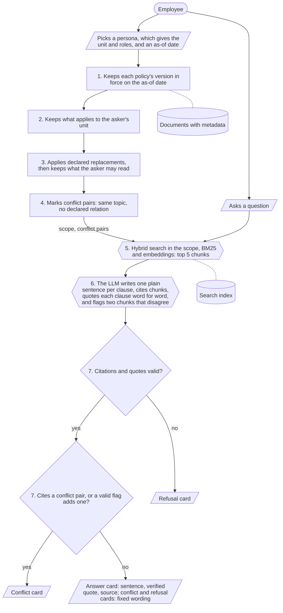
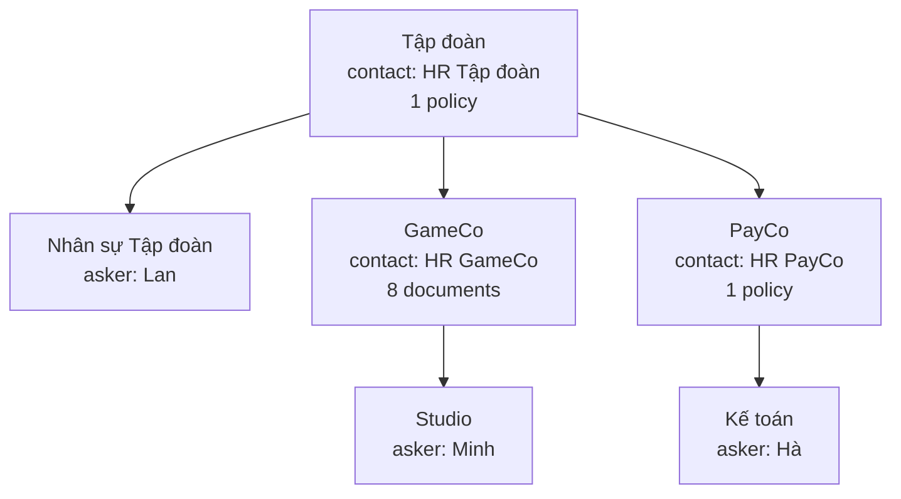

# Architecture

How v1 answers one question, and why the asker's scope is fixed before any AI runs.
Every unit, person, document and number on this page is simulated ("giả lập").
What v1 simplifies, defers and gets wrong is in [`scope.md`](scope.md); each design choice since Mission 1 has an ADR in [`decisions/`](decisions/).

## In one paragraph

The core loop of the brief is "câu hỏi + bối cảnh người dùng → tìm đúng tri thức → sử dụng đúng phạm vi → trả lời có nguồn kiểm chứng".
v1 splits it in two.
First, deterministic rules build the asker's scope from document metadata, the asker's unit and roles, and the as-of date, without reading the question and without any AI.
Then search and one LLM call work only inside that scope: the LLM picks the clauses that answer, writes one plain sentence per clause and quotes each clause, and rules check every citation and quote before choosing which of three cards to show.
So a wrong version, another unit's rule or a restricted document cannot reach an answer, because the AI never sees them.
The answer card shows the model's sentence above the quote the rules verified, then the source line (ADR 0011); the conflict and refusal cards show fixed wording and no model text.
What the AI can still get wrong is choosing which clause in the scope answers the question, and writing a sentence that drops a condition or adds a fact; the test report and Hiep's reading measure both.

## The 7 steps

The diagram uses the shapes of [`system_design.md`](system_design.md#21-how-to-read-the-diagrams): a hexagon calls an AI model, a rectangle or a diamond is a rule, a parallelogram is what the asker enters or sees, and a cylinder is a store.

The question enters only at step 5.
Steps 1-4 give the same scope for every question the same asker asks on the same date.
The Mission 1 design checked access in step 2; v1 checks it last, after step 3, so that whether the asker may read a document never decides which policy applies (ADR 0010).
A document the asker may not read still replaces its series, and the asker gets the refusal card instead of the replaced policy.

## Who decides what

Deterministic rules decide access, validity, applicability, precedence and the card.
The AI only works with language: it ranks chunks, picks the clauses that answer, writes one sentence per clause and quotes them (ADR 0011).

| Decision | Decided by | How | Code | If it goes wrong |
|---|---|---|---|---|
| Which version is in force (validity) | Rules, step 1 | Per series, the published version with the latest `effective_from` not after the as-of date; a draft or a future version never counts | `in_force` in `services/scope.py` | Deterministic and tested; wrong metadata gives a wrong version, so the owner must keep it right |
| Who may read it (access) | Rules, last, after step 3 (ADR 0010) | `access` against the asker's roles or unit; never decides which policy applies | `allowed` in `services/scope.py` | As above |
| Whether it applies to the asker (applicability) | Rules, step 2 | `applies_to` is the asker's unit or a unit above it | `applies` in `services/scope.py` | As above |
| Which policy wins (precedence) | Rules, step 3 | Only an `overrides` ("dùng thay") the owner declared; there is no default "lower unit wins" | `scope` in `services/scope.py` | An undeclared pair is not resolved, it becomes a conflict pair |
| Which policies conflict | Rules, step 4; plus the model's flag, checked by step 7 (ADR 0014) | Same `topic`, both kept, neither lists the other in `complements` ("bổ sung"); the model may add the pair of two cited chunks that disagree, never remove one | `scope` in `services/scope.py`, `flagged_pair` in `services/citations.py` | The rules never decide a conflict; the card sends the asker to HR |
| Which chunks are relevant | Search, step 5: BM25 plus `gemini-embedding-001` (ADRs 0001, 0002) | Ranks only the scope's chunks; anything outside the scope raises an error | `services/retrieval/search.py` | A missed chunk means the LLM finds nothing, so the asker gets a refusal: safe, but over-cautious |
| Which clauses answer the question | LLM, step 6: `gemini-3.5-flash-lite` (ADRs 0003, 0008) | Sees only the retrieved chunks and the asker's unit; may cite only retrieved ids, writes one plain sentence per clause, and quotes each clause word for word, or returns no points | `services/answering/` | See "What the rules cannot catch" below |
| Whether the answer is shown, and which card | Rules, step 7 (ADR 0003) | Refuses the whole answer if any point has no citation, cites a chunk that was not retrieved, or its quote is not in the cited chunk; a cited document in a conflict pair, or in a valid model flag, gives the conflict card | `card_for_answer` and `pick_card` in `services/citations.py` | Deterministic and tested |
| The answer card's sentence | LLM, step 6 | One plain Vietnamese sentence per point, naming the document; not checked at run time (ADR 0011); Hiep reads every sentence against its quote | `services/answering/`, `services/card_text.py` | A wrong sentence can mislead; the verified quote under it and the Faithfulness reading are the controls |
| The card kind, the verified quote, the source line, and the conflict and refusal text | Rules | The card kind comes from step 7 citations; the answer card shows the quote step 7 verified and the source line; the conflict card quotes one clause per side, chosen without reading meaning (ADRs 0003, 0005, 0011) | `services/card_text.py` | Deterministic and tested |

If Gemini fails after retries, the page shows an error, never a card.

### How the scope keeps out what the asker may not see

- The search index holds every chunk, but keyword statistics are computed over the scope only, the embedding search is filtered to the scope, and a final check raises `ScopeLeakError` if a chunk outside the scope is returned.
- The LLM sees only the retrieved chunks, so it cannot quote a document outside the scope.
- "Not allowed" and "not found" give the same refusal text, so a refusal does not reveal that a restricted document exists.
- A role claimed in the question ("Tôi là HR GameCo") changes nothing: roles come from the asker's profile, never from the question.

### What the rules cannot catch

- The LLM cites and quotes a clause in the scope that is real but does not answer the question.
  The quote check proves the clause exists, not that it answers; the test report reads every answer by hand.
- The model's sentence can add a fact, drop a condition such as "chính thức", or decide which rule applies, and no rule checks it (ADR 0011).
  The quote under it is checked, and Hiep's Faithfulness reading names the error; the model's disagreement flag (ADR 0014) catches an undeclared content conflict only when the model notices it and both clauses are retrieved.
- A question that needs the clause applied to a case, such as "nghỉ thứ Hai thì hạn chót nộp đơn là ngày nào?", is often refused although the clause is retrieved, because the LLM is told to answer only what is written ([#51](https://github.com/Park-Hip/next-gen-2026/issues/51)).
- A question about another period, such as next year, gets the version in force on the as-of date, because the rules never read the question ([#53](https://github.com/Park-Hip/next-gen-2026/issues/53)).
- Wrong metadata from an owner: the rules trust the metadata, and v1 has no check at publish time ([#50](https://github.com/Park-Hip/next-gen-2026/issues/50)); the model's flag can add the conflict a wrong topic or a wrong "bổ sung" hides, but cannot fix a wrong "dùng thay" or "access"; a document that applies to an asker who may not read it is the owner's error and is applied as written (ADR 0015).
- Conflicts are per document, not per question: when two policies in a conflict pair agree on the point asked, the asker still gets the conflict card ([#52](https://github.com/Park-Hip/next-gen-2026/issues/52)).
- A company that changes only one clause of a Group policy: "dùng thay" drops the whole Group policy ([#24](https://github.com/Park-Hip/next-gen-2026/issues/24)).

Each is an open issue labelled `limitation`; [`scope.md`](scope.md#known-limitations) lists them with the test rows that show them.

## What the brief asks the MVP to show

| The brief asks | How v1 does it | Test rows |
|---|---|---|
| Có dữ liệu giả lập ở nhiều cấp tổ chức | Group, two member companies and their units (diagram below); policies at Group and company level | 1, 5, 7 |
| Hiểu được bối cảnh người hỏi | The asker's unit and roles, from the signed-in simulated account that stands in for the HR system (ADR 0016), and the as-of date | 1, 2, 5, 7 |
| Không sử dụng/làm lộ thông tin ngoài quyền | Steps 1-4 build the scope before search; the search and the LLM never see anything outside it | 6, 10, 13 |
| Câu trả lời có nguồn/căn cứ | Every point has a plain sentence, chunk ids and a quote; step 7 checks the citation and the quote; the card names the document, the Điều and the effective date | 1, 3, 4 |
| Biết từ chối khi thiếu dữ liệu | The LLM may return no points; step 7 then shows the refusal card with the asker's HR contact | 8, 9, 11, 14 |
| Có khả năng xử lý phiên bản hoặc thông tin mâu thuẫn | Step 1 keeps the version in force; step 4 marks undeclared pairs and step 7 shows the conflict card | 2, 3, 7, 12 |

The questions, expectations and results of every row are in the [test report](mission2/test_report.md).

## The simulated organisation

A policy applies to its unit and every unit below it.
A card names the HR contact of the nearest unit above the asker that has one.

## Same question, three askers

The brief requires one question asked by two people with different contexts to give different, correct results.
Here Minh, Lan and Hà each ask "Phép năm của tôi là bao nhiêu ngày?" on 07/10/2026.
Minh works in Studio under GameCo, Lan in Nhân sự Tập đoàn at Group level with the roles `employee` and `hr_group`, and Hà in Kế toán under PayCo.

### Steps 1-4: the scope

Generated by `uv run python scripts/show_scope.py <minh|lan|ha> 2026-10-07 --why`, which calls the same rule functions as the product.

| Document | What it is | Minh | Lan | Hà |
|---|---|---|---|---|
| `LEAVE-GROUP-v1` | Group leave policy, 12 days, from 01/01/2024 | Dropped, step 3: `LEAVE-GAMECO-v2` declares it is used instead | **Kept** | **Kept** |
| `LEAVE-GAMECO-v1` | GameCo leave policy v1, 13 days, from 01/01/2024 | Dropped, step 1: replaced by v2 | Dropped, step 1 | Dropped, step 1 |
| `LEAVE-GAMECO-v2` | GameCo leave policy v2, 14 days, from 01/01/2026 | **Kept** | Dropped, step 2: applies to GameCo | Dropped, step 2: applies to GameCo |
| `LEAVE-GAMECO-v3` | GameCo leave policy v3, 15 days, from 01/01/2027 | Dropped, step 1: not in force until 01/01/2027 | Dropped, step 1 | Dropped, step 1 |
| `LEAVE-GAMECO-v4-DRAFT` | GameCo leave policy v4, 16 days, draft | Dropped, step 1: draft | Dropped, step 1 | Dropped, step 1 |
| `LEAVE-PAYCO-v1` | PayCo leave policy, 13 days, from 01/01/2025 | Dropped, step 2: applies to PayCo | Dropped, step 2: applies to PayCo | **Kept** |
| `LEAVE-PROC-GAMECO-v1` | How to request leave in GameCo's HR system; declared "bổ sung" to the GameCo leave policy | **Kept** | Dropped, step 2: applies to GameCo | Dropped, step 2: applies to GameCo |
| `OT-GAMECO-v1` | GameCo overtime rules | **Kept** | Dropped, step 2: applies to GameCo | Dropped, step 2: applies to GameCo |
| `SAL-BAND-GAMECO` | GameCo salary bands, readable by GameCo HR only | Dropped after step 3: access is GameCo HR only | Dropped, step 2: applies to GameCo | Dropped, step 2: applies to GameCo |
| `TRAVEL-GAMECO-v1` | GameCo travel expenses | **Kept** | Dropped, step 2: applies to GameCo | Dropped, step 2: applies to GameCo |
| **Conflict pairs (step 4)** | | None: the leave policy and the procedure share a topic, but the procedure declares "bổ sung" | None | `LEAVE-GROUP-v1` and `LEAVE-PAYCO-v1`: same topic, and neither declares a relation |

Step 1 does not depend on the asker, so GameCo v1, v3 and the v4 draft are dropped for all three.
Minh's search runs on 11 chunks, Lan's on 2 and Hà's on 4.

### Steps 5-7: the cards

From the 21/10/2026 run, [`20261021-1032`](../results/20261021-1032.jsonl), rows 1, 5 and 7; the card lines are copied word for word.

**Minh: answer card.**
Search returned five of his chunks; the LLM cited `LEAVE-GAMECO-v2#2`, and step 7 found its quote in that chunk, so the card shows the model's sentence above the quote.

> Bạn đang hỏi với tư cách: nhân sự GameCo, Studio.
> Theo Quy chế nghỉ phép GameCo (bản 2), nhân sự GameCo được nghỉ phép năm 14 ngày mỗi năm.
> "Nhân sự GameCo được nghỉ phép năm 14 ngày mỗi năm."
> Nguồn: Quy chế nghỉ phép GameCo (bản 2), Điều 2, hiệu lực từ 01/01/2026. Hỏi thêm: HR GameCo.

**Lan: answer card.**
Her scope has two chunks; the LLM cited `LEAVE-GROUP-v1#1`.
The sentence and the quote both keep the condition "chính thức"; step 7 checks the quote, not the sentence, so the employee reads both on the card.

> Bạn đang hỏi với tư cách: nhân sự Tập đoàn, Nhân sự Tập đoàn.
> Theo Quy chế nghỉ phép Tập đoàn, nhân sự chính thức của Tập đoàn được nghỉ phép năm 12 ngày mỗi năm.
> "Nhân sự chính thức của Tập đoàn được nghỉ phép năm 12 ngày mỗi năm."
> Nguồn: Quy chế nghỉ phép Tập đoàn, Điều 1, hiệu lực từ 01/01/2024. Hỏi thêm: HR Tập đoàn.

**Hà: conflict card.**
The LLM cited the PayCo clause, 13 days, with a correct quote.
Step 7 saw that the cited document is in a conflict pair, so it does not pick a side: the card quotes both clauses and sends Hà to HR.

> Bạn đang hỏi với tư cách: nhân sự PayCo, Kế toán.
> Có 2 quy định cùng áp dụng cho bạn nhưng chưa được khai báo quy định nào được dùng thay quy định nào. Hệ thống không tự chọn.
> Tập đoàn, Điều 1 (từ 01/01/2024): "Nhân sự chính thức của Tập đoàn được nghỉ phép năm 12 ngày mỗi năm."
> PayCo, Điều 1 (từ 01/01/2025): "Nhân sự PayCo được nghỉ phép năm 13 ngày mỗi năm."
> Vui lòng hỏi HR PayCo.

## The metadata model

Each document is a Markdown file in `data/documents/` with YAML front matter, then its text with one "Điều" per line.
In production the document owner, the HR of the unit, sets these fields; here they are simulated.

| Field | Example | Read by |
|---|---|---|
| `id`, `title`, `owner` | `LEAVE-GAMECO-v2`, "Quy chế nghỉ phép GameCo (bản 2)", HR GameCo | The card's source line |
| `series` | `LEAVE-GAMECO`: one policy across its versions | Step 1 |
| `status` | `published` or `draft` | Step 1 |
| `effective_from`, `effective_to` | `2026-01-01`; `effective_to` only when the policy really ends | Step 1, and the card's date |
| `access` | `all_staff`, `unit:<unit>` or `roles:<role>,<role>`; who may read, never who the document is for (ADR 0010) | Last, after step 3 |
| `applies_to` | `GameCo`: the unit and every unit below it | Step 2 |
| `overrides` | `LEAVE-GROUP`: the series this document is used instead of ("dùng thay"), for the units it applies to | Step 3 |
| `topic` | `nghi_phep`, one per document | Step 4, only to find conflict pairs (the model may add one, ADR 0014) |
| `complements` | `[LEAVE-GAMECO]`: series this document adds to without contradicting them ("bổ sung") | Step 4 |

An asker has a unit and roles (`data/personas.yaml`), the two fields an HR system would give.
The org tree (`data/org.yaml`) gives the unit's path up to the Group and its HR contact.
Documents are split into one chunk per "Điều", or per line for the procedure, which has no "Điều".

## Module map

All code is in `src/appota_kb/`; the folder layout is in [`development.md`](development.md#repository-layout).

| Step | Code | Tests | Settings and decisions |
|---|---|---|---|
| Load and validate the data; the load fails on two versions with the same start date, a self-override or an override cycle | `integrations/data_files.py` | `tests/integrations/test_data_files.py` | - |
| 1-4, the scope | `services/scope.py`, `services/chunking.py` | `tests/services/test_scope.py`, `tests/services/test_chunking.py`, `tests/test_parity.py` | ADR 0010 |
| 5, search | `services/retrieval/` | `tests/services/retrieval/` | `retrieval` in `config.yaml`; ADRs 0001, 0002 |
| 6, the LLM answer | `services/answering/`, `integrations/gemini.py` | `tests/services/answering/`, `tests/integrations/test_gemini.py` | `llm` in `config.yaml`; ADRs 0003, 0008, 0011 |
| 7, the card | `services/citations.py`, `services/card_text.py` | `tests/services/test_citations.py`, `tests/services/test_card_text.py` | ADRs 0003, 0005, 0011 |
| One question end to end | `services/ask.py`, used by both the page and the evaluation | `tests/services/test_ask.py` | - |
| The page | `api/page.py`, `api/templates/` | `tests/api/test_page.py` | `page` in `config.yaml`; ADR 0004 |
| The evaluation | `evaluation/` | `tests/evaluation/` | `eval` in `config.yaml`; ADRs 0006, 0007 |

The tests use a fake embedder and a fake LLM, so they need no key and no network; `tests/test_parity.py` checks the rules against the script the Mission 1 design was checked with.

### Where a change lands

| Change | Where |
|---|---|
| A new document, or a new version of one | A file in `data/documents/`; no code |
| A new unit or asker | `data/org.yaml`, `data/personas.yaml`; no code |
| A new test case | `data/test_cases.yaml` |
| A new kind of access rule | `allowed` in `services/scope.py` and the check in `integrations/data_files.py` |
| Real identity instead of the simulated sign-in | `load_personas` and the session lookup in `api/page.py`; the rules need only unit and roles |
| Another LLM or embedding model | `config.yaml`, with a new ADR, because ADRs 0002 and 0008 fix them |
| Search tuning | `retrieval` in `config.yaml`, with a new ADR (ADR 0002) |
| Card wording | `services/card_text.py` |
