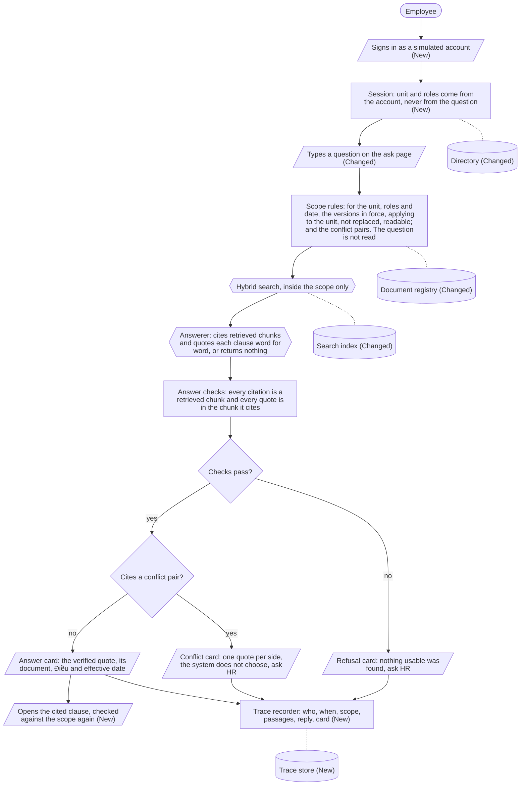
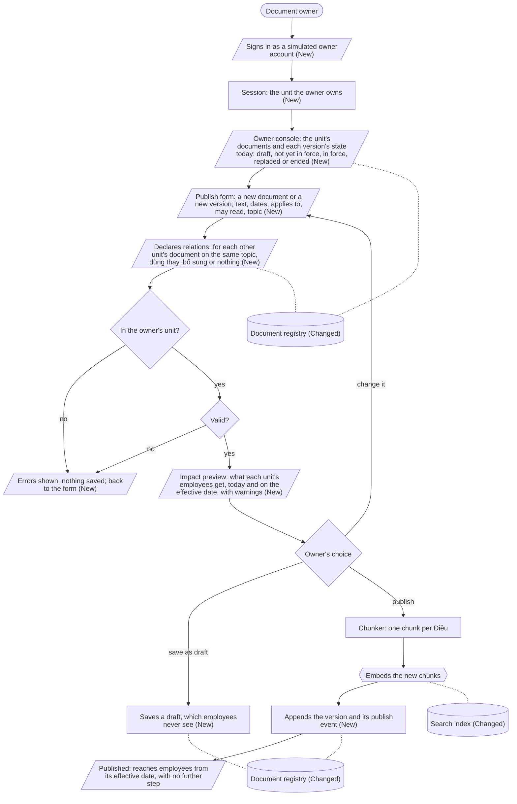
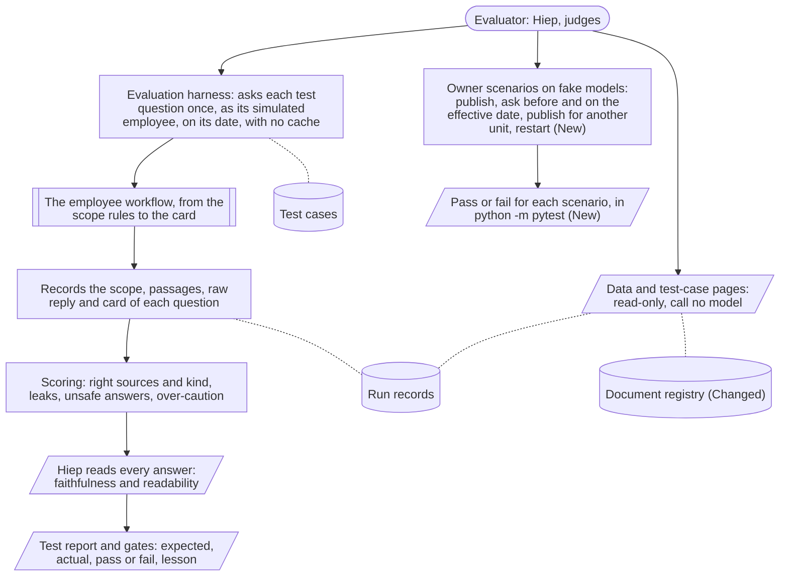
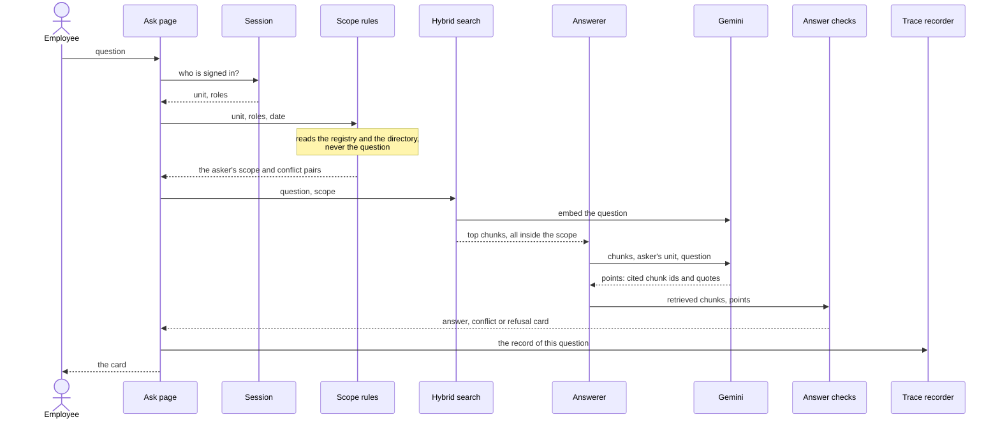
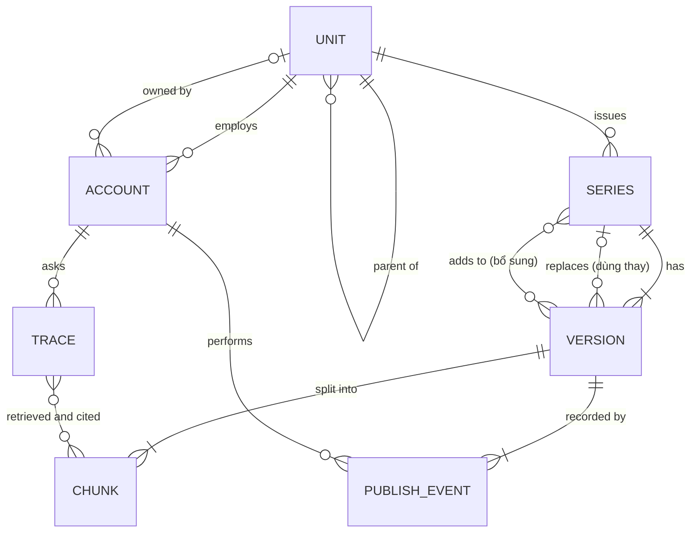
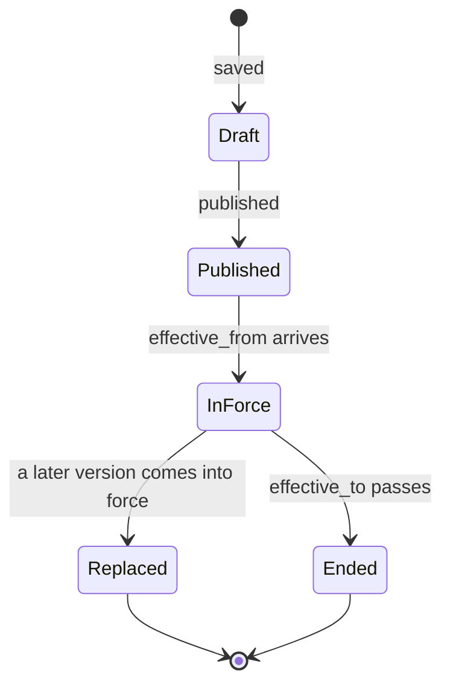

# System design - Tri thức nội bộ Appota

Status: draft by Claude (Opus 5.5), 20/10/2026, for Hiep to review.
Items marked **[to decide]** are open; every option marked "proposed" is Claude's proposal, not a decision.
All Appota data in this project is simulated ("giả lập").

## Contents

| Section | What it covers |
|---|---|
| [1. Scope](#1-scope) | What this design covers, and where the requirements are |
| [2. High-level design](#2-high-level-design) | One flowchart per workflow: employee, document owner, evaluator; then the components |
| [3. Main flows](#3-main-flows) | The same workflows as sequences, plus the effective date, restart and failures |
| [4. Data model](#4-data-model) | Entities, the information an owner sets, the checks when publishing, the life of a version |
| [5. Scope rules](#5-scope-rules) | The rules that decide which documents an asker may use |
| [6. Search, answer and checks](#6-search-answer-and-checks) | Chunking, search, the model call, the checks and the cards |
| [7. Owner side](#7-owner-side) | The owner console, declaring relations, the impact preview, correcting mistakes |
| [8. Identity and authorization](#8-identity-and-authorization) | Accounts, sign-in, who may do what, the as-of date |
| [9. Storage and persistence](#9-storage-and-persistence) | What is stored, where, and how it survives a restart |
| [10. Traceability and observability](#10-traceability-and-observability) | The record of each answer, logs, explaining a wrong answer |
| [11. Security and privacy](#11-security-and-privacy) | How nothing outside the asker's rights gets out, and the new surfaces |
| [12. Failure modes and limitations](#12-failure-modes-and-limitations) | What can still go wrong, and where this design stands on each known limitation |
| [13. Deployment and operations](#13-deployment-and-operations) | Host, process, models, limits, secrets, configuration |
| [14. Evaluation](#14-evaluation) | How each metric of the spec is measured |
| [15. Decisions](#15-decisions) | The ADRs this design relies on, and the decisions it needs |
| [16. Change readiness](#16-change-readiness) | Where a likely change lands, and what stays |
| [17. Open questions](#17-open-questions) | What is still open |
| [Appendix A](#appendix-a-requirements-traceability) | Each requirement, the components and flows that meet it, and its test |

## 1. Scope

[`mvp_spec.md`](mvp_spec.md) is the source of truth for what the MVP must do: its users, its requirements E1-E8, H1-H5 and S1-S5, its constraints, assumptions and metrics.
This document describes how the system is built to meet them; it cites them by ID and does not restate them.
How v1 answers one question step by step is in [`architecture.md`](architecture.md), what v1 simplifies and defers is in [`scope.md`](scope.md), and why each choice was made is in [`decisions/`](decisions/README.md).

In scope, from the spec:

- An employee asks a question and gets an answer, a conflict notice or a refusal (spec 3.1).
- A document owner publishes documents and versions, declares relations and sees the state of the unit's documents (spec 3.2).
- The system keeps what was published, records every answer and runs in a browser in Vietnamese (spec 3.3).
- The evaluation of spec section 6, for both test questions and owner scenarios.

Out of scope: everything listed under "Deferred" in [`scope.md`](scope.md), such as real single sign-on, DOCX and PDF documents, multi-turn conversation and "Báo sai".
The inputs and their form are fixed by spec section 4; the assumptions A1-A4 of spec section 5 hold throughout.

The expected size is the size of the simulated data: tens of documents, a handful of simulated accounts and one server process.
No number in this document is a measurement unless it names its source.

A choice with real alternatives is shown as **[to decide]** with its options; it is decided by Hiep, through a research issue when it needs one, and recorded in an ADR.
This document never gives the reasons for a decision on Hiep's behalf.

## 2. High-level design

The system has three workflows, one per kind of user.
The employee's and the owner's workflows meet only in the document registry and the search index: the owner's workflow writes them, and the employee's workflow only reads them.
The evaluator's workflow runs the employee's workflow unchanged, so the evaluation tests what employees get.

### 2.1 How to read the diagrams

The diagrams use shapes, not colour, to show what each step is.

| Shape | Means |
|---|---|
| Pill | A person |
| Parallelogram | What a person enters or sees on a page |
| Rectangle | A step done by deterministic rules or plain code, with no AI |
| Hexagon | A step that calls an AI model |
| Diamond | A decision taken by rules |
| Rectangle with double sides | Another workflow, run as one step |
| Cylinder | A store; the same store can be drawn twice to keep lines short |

A solid arrow leads to the next step; a dotted line joins a step to a store it reads or writes.
"(New)" marks a step that v1 does not have, and "(Changed)" a step that v1 has but this design changes; a step with no marker is built in v1 and unchanged.

### 2.2 Employee: asking a question

- The question is read only from search onwards; the scope rules give the same scope for every question the same asker asks on the same date.
- No card shows text the model wrote: the answer card shows the quote the checks verified, and the conflict and refusal cards use fixed wording (ADR 0009).
- The order of the rules inside the scope rules is described in [`architecture.md`](architecture.md#the-7-steps).

### 2.3 Document owner: publishing and checking documents

- An owner may publish only for the unit they own, with `applies_to` that unit or a unit below it (H5).
- The impact preview uses the same scope rules as the employee's workflow, so it shows what employees will actually get.
- The new version is embedded before it is saved, so the registry never names a chunk the index does not have (proposed).
- Nothing runs on the effective date: which version is in force is computed for each question (section 3.4).

### 2.4 Evaluator: testing the system

- The evaluator is Hiep when building, and the judges when looking at the demo.
- Test questions go through the employee's workflow with no cache.
- Owner scenarios need no model to decide pass or fail, because the scope rules decide which documents an answer may use.

### 2.5 Components

| Component | Responsibility | Decided by | Requirements | Status | v1 code |
|---|---|---|---|---|---|
| Ask page | The question form, the three cards, and the cited clause | Rules render fixed or verified text | E1, E7, S5 | **Changed**: the asker comes from the session instead of the persona picker; the cited clause can be opened (section 6.5) | `api/page.py`, `api/templates/` |
| Owner console | The unit's documents with their state today, the publish form, drafts | Rules | H1-H4 | **New** | - |
| Data and test-case pages | Read-only views of the simulated data and of the committed evaluation run, calling no model | Rules | Evaluation | **Built**; visibility to decide (section 8.3) | `api/page.py`, `services/guide.py` |
| Sign-in and session | Turns a signed-in simulated account into the principal: unit, roles, owned unit | Rules | E8, H5 | **New**: v1 has a persona picker | - |
| Directory | The org tree, each unit's HR contact, the accounts | Data | E2, E6, E8 | **Changed**: accounts gain the unit they own | `data/org.yaml`, `data/personas.yaml`, `integrations/data_files.py` |
| Document registry | Every version of every document with its metadata, relations and publish events; only appended to | Data | H1, H2, S4 | **Changed**: files in the repository become a persistent store (section 9) | `data/documents/`, `integrations/data_files.py` |
| Publish service | Checks the owner may publish for the unit, validates the document, shows its impact, saves it and indexes it | Rules | H1, H2, H3, H5 | **New**; the load checks of v1 are its starting point | `integrations/data_files.py` (checks only) |
| Chunker | One chunk per "Điều", or per line for a document without "Điều" | Rules | E7 | **Built** | `services/chunking.py` |
| Search index | Every chunk of every version, with its embedding and its BM25 tokens | Data | E1 | **Changed**: built at start-up in v1; also updated on publish | `services/retrieval/index.py` |
| Scope rules | The documents the asker may use on the date: in force, applying to the asker's unit, not replaced, readable by the asker; and the conflict pairs | Rules | E2-E5 | **Built** | `services/scope.py` |
| Hybrid search | Ranks only the asker's chunks by BM25 and embeddings, fused by RRF, and raises an error on any chunk outside the scope | AI ranks, rules guard | E1, E4 | **Built** | `services/retrieval/` |
| Answerer | One LLM call that cites only retrieved chunk ids and quotes each clause word for word, or returns nothing | AI | E1, S1 | **Built** | `services/answering/`, `integrations/gemini.py` |
| Answer checks and card | Verifies every citation and quote, picks the answer, conflict or refusal card, and fills in its fixed wording | Rules | S1, S2, E5, E6, E7 | **Built** | `services/citations.py`, `services/card_text.py` |
| Trace recorder | One record per question: who, when, scope, retrieved passages, raw model reply, checks, card | Rules | S3 | **New**: v1 has JSON log lines on standard output and the evaluation's JSONL files | `evaluation/run.py` (record shape) |
| Evaluation harness | Runs the test questions through the ask function and scores them; runs the owner scenarios | Rules, plus Hiep's reading | Spec 6 | **Built** for test questions; **New** for owner scenarios | `evaluation/`, `tests/` |

### 2.6 What stays and what is added

The answering half of the system is built and stays as it is: the scope rules, search, the answerer and the answer checks, with the guarantees described in [`architecture.md`](architecture.md).
The design adds three things around it:

1. **Who is asking comes from a signed-in account.** The rules already need only a unit and roles, so only the source of the principal changes.
2. **Owners publish through the system instead of editing files.** Publishing writes to a persistent registry and to the search index; the scope rules read the registry instead of `data/documents/`.
3. **Every answer leaves a record.** The page writes the same kind of record the evaluation already writes.

The answering half never writes and the publishing half never answers, so they meet only in the registry and the index.

## 3. Main flows

### 3.1 An employee asks a question

- The question first enters at search; everything before that is the same for every question the same asker asks on the same date.
- The date is today in Vietnam in production; the demo and the evaluation set it on purpose to show a version change (section 8.4).
- The internal order of the rules and checks is described in [`architecture.md`](architecture.md#the-7-steps).

### 3.2 An owner publishes a document or a new version

- Errors block publishing; warnings are shown and the owner decides (section 7.4).
- The new version is indexed before it is saved, so the registry never names a chunk that the index does not have (proposed; section 3.6).
- Saving a draft runs the same checks except the impact preview, and never reaches employees.

### 3.3 An owner checks the state of the unit's documents

The owner console lists every series of the owner's unit with each version and its state today: draft, published but not yet in force, in force, replaced, or ended.
The state comes from the same rule function that decides validity for employees, so the console cannot disagree with what employees are told (proposed).
In v1, the "Dữ liệu giả lập" page computes these states in `services/guide.py`, separately from the rules.

### 3.4 An effective date arrives

Nothing runs on that day.
Which version is in force is computed for every question from the date, and the version was indexed when it was published, so the new rule reaches employees from its effective date and not before (H3).
The demo's answer cache is keyed by the scope's chunk ids, so a scope that changes with the date never reuses an old answer.

### 3.5 Start-up and restart

1. Load `config.yaml` through `core/config.py`.
2. Connect to the registry; if it is empty, load the simulated documents of `data/documents/` into it once (proposed).
3. Load the directory from `data/org.yaml` and the accounts file.
4. Build or load the search index **[to decide]**: v1 embeds every chunk at start-up; a persistent store could keep the vectors (section 9).
5. Load the committed evaluation run for the test-case page.

Any invalid data stops the start-up, so the deploy fails its health check instead of serving wrong answers, as in v1.
A restart must keep every published document and its history (S4, Owner scenarios).

### 3.6 When something fails

| Failure | What happens | Status |
|---|---|---|
| Gemini fails after retries, or the rate limit is reached | The page shows "Hệ thống tạm thời không trả lời được..." and no card; the trace records the error | Built (trace New) |
| Search returns a chunk outside the scope | `ScopeLeakError`; no card | Built |
| A chunk of the scope is missing from the index | Search raises an error naming the chunk; no card | Built |
| The model's output is malformed, cites nothing, cites outside what was retrieved, or quotes text not in the cited chunk | Refusal card | Built |
| A publish fails validation | Nothing is saved; the console shows the errors | New |
| Indexing fails during a publish | Nothing is saved; the owner retries (proposed: index first, then save) | New |
| The registry is unreachable | Error page for questions and publishing; never an answer from stale data (proposed) | New |

## 4. Data model

### 4.1 Entities

| Entity | What it is | Status |
|---|---|---|
| Unit | A node of the fixed org tree, with an optional HR contact; a unit without one uses the nearest unit above | Built |
| Account | A simulated person: name, unit, roles, and the unit they own if they are an owner | Changed: v1 personas have no owned unit and no sign-in |
| Series | One document across its versions, issued by one unit | Built, as the `series` field |
| Version | One edition of a series with its metadata and text; what v1 calls a document | Built |
| Relation | "Dùng thay" or "bổ sung" from a version to another series | Built, as fields of a version |
| Chunk | One "Điều" of a version, or one line of a document without "Điều" | Built |
| Publish event | Who published or saved which version, and when | New |
| Trace | The record of one question (section 10) | New |

### 4.2 The information an owner sets for each document

This section answers the first open question of the spec (section 4): the exact list.
The list below is v1's metadata plus the fields publishing needs; it is a proposal **[to decide]**.

| Field | Meaning | Set by | v1 |
|---|---|---|---|
| `id` | The version's identifier | The system, from the series and a version number (proposed) | Typed by hand |
| `series` | The document across versions | The system: a new series, or the series the owner chose to add a version to | Typed by hand |
| `title` | The title shown on the card | Owner | Same |
| `issuer` | The unit that issues the document | The system: the owner's unit (proposed) | Not a field; `owner` holds the HR contact's name |
| `topic` | One subject from a fixed list, used only to find conflict pairs | Owner, from the list **[to decide: who maintains the list]** | Same, free text |
| `status` | `draft` or `published` | Owner, by saving or publishing | Same |
| `effective_from` | The first day it is in force | Owner | Same |
| `effective_to` | The last day, only when the rule really ends | Owner, optional | Same |
| `applies_to` | The unit it applies to, with every unit below it | Owner, within the owner's unit | Same |
| `access` | Who may read it: all staff, one unit, or some roles; never who it is for (ADR 0010) | Owner | Same |
| `overrides` | The series it is used instead of, for the units it applies to ("dùng thay") | Owner | Same |
| `complements` | The series it adds to without contradicting them ("bổ sung") | Owner | Same |
| `published_by`, `published_at` | Who published it, and when | The system | New |
| Body | Markdown text, each clause on its own line starting with "Điều n." | Owner | Same |

### 4.3 Checks when publishing

**Errors** stop the publish; the first group already stops v1's start-up (`integrations/data_files.py`, `services/chunking.py`).

| Check | v1 |
|---|---|
| `status` is `draft` or `published`; `access` has a known form | Built |
| `effective_to` is not before `effective_from` | Built |
| No two published versions of a series start on the same day | Built |
| `overrides` does not name its own series, and no chain of overrides forms a cycle | Built |
| `overrides` and `complements` name series that exist | Built |
| The body does not mix "Điều" lines with plain lines, and repeats no "Điều" number | Built |
| The issuing unit is the owner's unit, and `applies_to` is that unit or a unit below it (H5) | New |
| The roles and units in `access` exist | New |
| A published version may not start before today **[to decide]**; otherwise a publish rewrites what employees were told in the past | New |
| `overrides` may name only a series of a unit above the issuing unit **[to decide]** | New |

**Warnings** are shown in the impact preview, and the owner decides:

- A new conflict pair: a document on the same topic applies to some of the same units and no relation is declared, so those employees will get the conflict card.
- A new version that fewer people may read than the version it replaces: by ADR 0010, the employees who lose access get a refusal, not the older rule.
- A version that replaces another series takes away every clause of that series for the units it applies to ([#24](https://github.com/Park-Hip/next-gen-2026/issues/24)).

### 4.4 The life of a version

Only "draft" and "published" are stored.
"Published but not yet in force", "in force", "replaced" and "ended" are computed from the dates of the series' versions and the date asked, so no job has to change them on the day.
How a mistake in a published version is corrected is open (section 7.5).

## 5. Scope rules

The rules are built and tested; [`architecture.md`](architecture.md#who-decides-what) gives each rule, its code and what happens when it goes wrong.
In short, for one account and one date:

1. Keep, per series, the published version in force on that date.
2. Keep the versions that apply to the asker's unit or a unit above it.
3. Drop the series that a kept version declares it is used instead of.
4. Keep what the asker may read; access comes last, so it never decides precedence (ADR 0010).
5. Mark as conflict pairs the kept documents on the same topic with no declared relation.

The full design changes the rules' inputs, not the rules:

- The documents come from the registry instead of `data/documents/`.
- The unit and roles come from the session instead of the persona picker.
- The publish service and the owner console call the same functions to preview impact and to show state, so there is one definition of "in force" and "applies" (proposed).

## 6. Search, answer and checks

### 6.1 Chunking and the index

- One chunk per "Điều", or per line for a document without "Điều"; a chunk's id is the version id and its number (`LEAVE-GAMECO-v2#2`).
- The text indexed is the document title followed by the chunk, for both BM25 and embeddings.
- The index holds every chunk of every version, including drafts, future and replaced versions; the scope is applied at search time, so a version needs no re-indexing when it comes into force.
- Changed: v1 embeds everything at start-up; in the full design, publishing adds the new version's chunks (section 3.2).

### 6.2 Search

- BM25 over Vietnamese syllables, with its statistics computed over the asker's scope only, and cosine similarity over `gemini-embedding-001`, fused by reciprocal rank fusion (ADRs 0001, 0002).
- The top 5 chunks go to the answerer (`retrieval.top_k` in `config.yaml`).
- Only chunks of the asker's scope are scored, and a final check raises `ScopeLeakError` on any other chunk.

### 6.3 The answerer

- One call to `gemini-3.5-flash-lite` at medium thinking (ADR 0008), with no sampling and with structured output.
- The model sees only the retrieved chunks, the asker's unit and the question.
- It returns `{points: [{chunks, quote}]}`: each point cites retrieved chunk ids, from an enumerated list, and quotes the clause word for word; or it returns no points (ADR 0003).

### 6.4 The checks and the card

- The whole answer is refused if the output is malformed, has no points, has a point with no citation, cites a chunk that was not retrieved, or quotes text that is not in a chunk it cites, after Unicode and whitespace folding.
- If a cited document is in a conflict pair, the card is the conflict card, quoting one clause per side chosen without reading meaning (ADR 0005).
- Otherwise the card is the answer card, showing the verified quotes, never a sentence the model wrote (ADR 0009).
- Every card starts with who the asker is asking as, and the answer card names the document, the "Điều", the effective date and the HR contact (E7).
- "Not allowed" and "not found" give the same refusal text (E4).
- **[to decide]** (SD14): E1 asks for an answer "in plain Vietnamese that answers it directly", which a quote does not always give; a worded answer would need a new ADR that supersedes ADR 0009.

### 6.5 Reading the cited part (E7)

The spec asks that the employee "can read that part".
v1 shows the quote, which can be only part of a clause.
Proposed **[to decide]**: the answer card links to the full cited "Điều" of that version; the server checks that the chunk is in the asker's scope for that date before showing it, so the link cannot be used to read another document (section 11).

### 6.6 The demo cache

An in-process cache of the last 256 replies, keyed by the account, the scope's chunk ids and the question; the checks still run on every hit, and the evaluation never uses it.
In the full design the key uses the account id instead of the persona id.

## 7. Owner side

All of this section is **New**.
It covers H1-H5; approval workflows, notifications and periodic review stay deferred ([`scope.md`](scope.md#owners-and-workflow)).

### 7.1 What an owner can do

An owner owns exactly one unit, and may publish and see only that unit's documents (H5).
Whether an owner also sees the documents of units below their unit is open (section 15).

### 7.2 The owner console

| Page | Shows or does | Requirement |
|---|---|---|
| The unit's documents | Each series with its versions, each version's state today, its dates, who it applies to, who may read it and its relations | H4 |
| One version | The full text, its metadata and its publish events | H4, S4 |
| Publish | The form of section 7.3, then the impact preview, then confirm | H1, H2 |
| Drafts | Saved drafts, which employees never see | H1 |

### 7.3 Declaring relations (H2)

The owner should not have to know other units' series ids.
Proposed: when the owner picks a topic and the units the document applies to, the form lists the documents of other units on the same topic that also apply to some of those units, and for each one the owner chooses:

- **Dùng thay**: this document replaces it for the units it applies to.
- **Bổ sung**: this document adds to it without contradicting it.
- **Not declared**: the employees of those units will get the conflict card, and the preview says so.

The list is built by the scope rules from metadata only; no AI suggests a relation, an idea [`scope.md`](scope.md#owners-and-workflow) keeps deferred.

### 7.4 The impact preview

Before confirming, the owner sees, for each unit the document applies to, on today's date and on its effective date:

- which documents employees of that unit will use, and which ones leave their scope;
- the new conflict pairs;
- the warnings of section 4.3.

The preview shows only documents the owner may read, so it cannot reveal another unit's restricted document (proposed).
It partly mitigates [#50](https://github.com/Park-Hip/next-gen-2026/issues/50): a wrong topic or a wrong relation becomes visible before employees see it, but nothing proves the owner reads it.

### 7.5 Correcting a mistake **[to decide]**

Options:

- a) Only by a new version; the wrong version stays in force until the new one starts.
- b) Withdraw a version that is not yet in force, which keeps its record but removes it from the rules.
- c) Withdraw any version, including one in force, with the same record.

Whatever is chosen, the record of what was published and when is never deleted (S4).

## 8. Identity and authorization

### 8.1 Accounts

A simulated account has an id, a name, a unit, a set of roles, and optionally the unit it owns.
Accounts replace `data/personas.yaml`; Minh, Lan and Hà remain as employees, and one owner account is added per unit that issues documents (proposed).

### 8.2 Sign-in **[to decide]**

Options:

- a) A sign-in page lists the simulated accounts; the user picks one, and the server keeps the account id in a signed session cookie (proposed).
- b) Each simulated account has a password.
- c) Real single sign-on, which stays deferred ([`scope.md`](scope.md#simplified)).

In a and b the server reads the unit and roles from the account, never from the request or the question, which is what E8 requires.

### 8.3 Who may do what

Every check runs on the server for every request; hiding a button is not a check.

| Action | Employee | Owner of unit U | Evaluator |
|---|---|---|---|
| Ask a question | Yes | Yes, as an employee of their own unit | Through the evaluation harness |
| Open a cited clause | Only a chunk in their scope on that date | Same | Same |
| See unit U's documents and their state | No | Yes | **[to decide]** |
| Publish or save a draft for U | No | Yes | No |
| See the "Dữ liệu giả lập" page | **[to decide]** | **[to decide]** | Yes |
| See the "Tình huống kiểm thử" page | **[to decide]** | **[to decide]** | Yes |

The "Dữ liệu giả lập" page lists every document with its title, including restricted ones such as "Khung bậc lương GameCo".
That is right for judges looking at simulated data, but in a product where employees sign in it would break E4, which forbids even showing a document's title.

### 8.4 The as-of date

In production the date is always today in Vietnam.
v1 lets the user pick the date so that judges can see a version change without waiting for it.
Whether the signed-in demo keeps the date picker for everyone, only for the evaluator, or not at all is **[to decide]**.

## 9. Storage and persistence

### 9.1 What is stored

| Data | Written by | Read by | Survives a restart |
|---|---|---|---|
| Versions, their text and metadata, publish events | Publish service | Scope rules, owner console, data page | Required (S4) |
| Org tree and accounts | Nobody at run time: loaded from `data/` | Session, scope rules, cards | From the repository |
| Search index | Start-up and publish service | Search | Can be rebuilt from the versions |
| Traces | Trace recorder | Evaluator | Required (S3) |
| Evaluation runs | Evaluation harness | Report, test-case page | Committed to the repository, as in v1 |

### 9.2 Where it is stored **[to decide]**

The requirement that published documents survive a restart conflicts with today's host: by ADR 0004, a Render free web service loses its local files on every spin-down, restart or redeploy.
This needs a research issue and an ADR.
Options to research; none of their limits or prices has been checked for this document:

- a) A hosted Postgres database, such as Neon, Supabase or Render Postgres, the options ADR 0004 listed for "Báo sai" records; possibly with pgvector to keep the embeddings too.
- b) A SQLite file on a host with a persistent disk, which means changing host.
- c) Published documents committed to the GitHub repository through its API.
- d) Keep files and accept the loss, which fails S4 and the restart scenario.

Two questions follow from the choice:

- Whether the embeddings are stored or recomputed at every start-up; recomputing costs embedding calls on the Gemini free tier as documents grow.
- How two publishes at the same time are kept apart; with one process, a single lock is enough (proposed).

## 10. Traceability and observability

### 10.1 The trace record (S3)

Proposed: the page writes one record per question in the same shape the evaluation already writes in `results/*.jsonl`, so the same scoring and reading tools work on both.
The evaluation record today holds the run id, the asker, the date, the question, the status and error, the commit, the model, thinking level, embedding model and top k, the scope's documents, conflict pairs and chunks, the retrieved chunks and their text, the raw model reply, the points, the card and the latency.
The page's record adds a trace id, the account id instead of the persona, and whether the cache answered.

Open **[to decide]**:

- Whether the card shows the trace id, so an employee can quote it to HR.
- How long traces are kept; the questions are simulated now, but a real question can be personal.

### 10.2 Logs

v1 writes one JSON log line per search, per model answer and per page request on standard output; the design keeps them for operating the server, and the trace store becomes the record that S3 relies on.

### 10.3 Explaining a wrong answer

From a trace, the evaluator sees which documents the rules kept, which chunks search returned, what the model replied and which check decided the card, without calling any model.
Rescoring a saved run without calling the API already works for the evaluation (ADR 0006).

## 11. Security and privacy

### 11.1 How nothing outside the asker's rights gets out (E4, E8)

1. The scope rules remove what the asker may not read before the question is read.
2. Search scores only the scope's chunks, and raises an error on any other chunk.
3. The model sees only the retrieved chunks, so it cannot quote anything else.
4. The checks refuse any citation outside what was retrieved and any quote not in the cited chunk.
5. "Not allowed" and "not found" give the same refusal, so a refusal does not reveal that a document exists.
6. Unit and roles come from the account; a role claimed in the question changes nothing.

Tests already check that no restricted chunk reaches any asker's scope for every asker, every boundary date and every test question, and with seven trap edits to the data (`tests/services/test_scope.py`).

### 11.2 New surfaces this design adds

| Surface | Risk | Control |
|---|---|---|
| The cited-clause link | Opening a chunk id of another document | The server checks the chunk is in the asker's scope for that date (section 6.5) |
| The owner console | Reading or publishing for another unit | Server-side check of the owned unit on every request (section 8.3) |
| The impact preview | Showing another unit's restricted document | The preview shows only what the owner may read (section 7.4) |
| The data and test-case pages | Showing restricted titles to employees | Visibility to decide (section 8.3) |
| The session cookie | A forged account | Signed with a secret from the environment |
| Document text written by owners | Instructions to the model inside a document | The model's output can only cite and quote retrieved chunks, so at worst it gives a refusal or a real but unhelpful quote |

### 11.3 Secrets and data

- The Gemini key, the session secret and any database URL come from the environment only, never from `config.yaml` or the repository.
- The repository is public; all data is simulated.

## 12. Failure modes and limitations

The two failures that look like right answers matter most, because the employee cannot tell them from a right answer; the safe ones send the employee to HR.

| Failure | Looks like | Caught by | In this design |
|---|---|---|---|
| The model quotes a real clause in scope that does not answer the question | A right answer | Hiep's reading in the evaluation; the employee reads the quote and its source | Unchanged |
| An owner sets wrong metadata, such as a wrong topic or a wrong relation ([#50](https://github.com/Park-Hip/next-gen-2026/issues/50)) | A right answer | Nothing in v1 | Partly mitigated by the relation list and the impact preview (sections 7.3, 7.4) |
| A question about another period gets the rule in force on the date asked ([#53](https://github.com/Park-Hip/next-gen-2026/issues/53)) | A right answer | The evaluation | Unchanged; see section 16 |
| A company replaces only one clause of a Group policy, and the whole Group policy drops out ([#24](https://github.com/Park-Hip/next-gen-2026/issues/24)) | A refusal | The evaluation | A warning in the impact preview (section 4.3); clause-level relations stay deferred |
| Two policies in a conflict pair agree on the point asked, and the employee still gets the conflict card ([#52](https://github.com/Park-Hip/next-gen-2026/issues/52)) | A conflict notice | The evaluation | Unchanged |
| A question that needs a clause applied to a case is refused although the clause was found ([#51](https://github.com/Park-Hip/next-gen-2026/issues/51)) | A refusal | The evaluation | Unchanged |
| The registry or the host loses published documents | Answers from the old rules | The restart scenario | Depends on section 9.2 |

Each of the five issues stays open with the `limitation` label until it is fixed.

## 13. Deployment and operations

| Area | Today | Source |
|---|---|---|
| Host | A Render free web service in Singapore, auto-deploying from a Blueprint; it sleeps after 15 idle minutes and wakes in about a minute | ADR 0004 |
| Process | One uvicorn process; the index and the model clients are built at start-up, so invalid data or a missing key fails the health check | `main.py` |
| Models | `gemini-3.5-flash-lite` at medium thinking, `gemini-embedding-001` | `config.yaml`; ADRs 0002, 0008 |
| Limits | 12 requests a minute, 80% of the free-tier limit; 6 retries; 30 seconds per attempt; questions up to 300 characters | `config.yaml`; ADR 0008 |
| Secrets | `GEMINI_API_KEY`, set only in the Render dashboard | ADR 0004 |
| Configuration | Every tunable value in `config.yaml`, read only through `core/config.py` | AGENTS.md |

The full design adds a session secret and, depending on section 9.2, a database URL, both from the environment.
New `config.yaml` keys are added by the change whose code first reads them.

## 14. Evaluation

How each metric of spec section 6.2 is measured:

| Metric | How | Status |
|---|---|---|
| Right sources and right kind | Each test question's scope and card compared with its expected documents and kind; gate "Rules correct in every case" | Built |
| Leaks | Gate "Leaks", plus the exhaustive scope test of section 11.1 | Built |
| Unsafe answers | Gates on the card and on the raw model reply, confirmed by hand (ADR 0006) | Built |
| Faithfulness | Hiep reads every answer, statement by statement, in a review file next to the run | Built |
| Over-caution | At most 10% of the questions that expect an answer (`eval.over_cautious_max_share`) | Built |
| Readability | Read by a person; the criterion is open in the spec | **[to decide]** |
| Source shown | Each answer card names the document, the part, the version and its date, and the part can be opened | Changed: the card already names them; opening the part is section 6.5; whether this is checked automatically today is to be checked |
| Traceable answers | Every question has a trace with its scope, retrieved chunks and reply | New: v1 has this for evaluation runs only |
| Owner scenarios | Automated tests on fake models: publish, then ask before and on the effective date; publish for another unit and be stopped; see the state; restart and ask again | New |

Owner scenarios need no LLM to decide pass or fail, because the scope rules decide which documents an answer may use; they can run in `python -m pytest` with the fake embedder and the fake model the tests already use.

## 15. Decisions

### 15.1 Decisions already made

The ADRs in [`decisions/`](decisions/README.md) hold for the full design; the ones it relies on most are:

- ADRs 0001, 0002: search on LangChain core, with our own Vietnamese BM25, `gemini-embedding-001` and RRF.
- ADRs 0003, 0008, 0009: one model call that cites retrieved ids and quotes; the card shows the verified quote.
- ADR 0004: the host, and leaving "Báo sai" and the owners' page out of Mission 2; the owner console of this design reverses the second part and needs a new ADR.
- ADR 0005: the conflict card.
- ADR 0010: access is checked last.

### 15.2 Decisions this design needs

| # | Decision | Options | Needs research | Section |
|---|---|---|---|---|
| SD1 | Where published documents and traces are stored, and on which host | Section 9.2 a-d | Yes | 9.2 |
| SD2 | Whether embeddings are stored or recomputed at start-up | Store; recompute | With SD1 | 3.5, 9.2 |
| SD3 | How a user signs in | Section 8.2 a-c | No | 8.2 |
| SD4 | The information an owner sets for each document | Section 4.2 | No | 4.2 |
| SD5 | Who maintains the list of topics | Owners; one central owner; a fixed list in the data | No | 4.2 |
| SD6 | Whether a published version may start before today | Allow; refuse | No | 4.3 |
| SD7 | Which series `overrides` may name | Any; only a series of a unit above | No | 4.3 |
| SD8 | How a mistake in a published version is corrected | Section 7.5 a-c | No | 7.5 |
| SD9 | Whether an owner also sees and publishes for units below their unit | Own unit only; own unit and below | No | 7.1 |
| SD10 | Whether the card links to the full cited clause | Link; quote only | No | 6.5 |
| SD11 | Who sees the data and test-case pages, and the date picker | Everyone; evaluator only | No | 8.3, 8.4 |
| SD12 | Whether the card shows a trace id, and how long traces are kept | - | No | 10.1 |
| SD13 | Whether the HR contact receives unanswered questions or is only named | Section 17 | No | 17 |
| SD14 | Whether the answer card keeps showing only the verified quote, or also a sentence the model words | Keep ADR 0009; a worded answer shown with its verified quote | Possibly | 6.4 |

## 16. Change readiness

Where a likely change lands, and what stays as it is.
The rows are candidates from the Mission 1 decisions and the deferred list, not commitments.

| Change | Lands in | Stays |
|---|---|---|
| A person in two units (kiêm nhiệm) | Accounts hold several units; the scope rules run once per unit, or the user picks the unit they ask for | Search, the answerer, the checks |
| A company replaces one clause of a Group policy ([#24](https://github.com/Park-Hip/next-gen-2026/issues/24)) | Relations point at chunks instead of series; the scope rules drop chunks instead of documents | Search, the answerer, the cards |
| Employment type or seniority decides applicability | A new field on versions and accounts, and one more rule in the scope rules | Everything after the scope |
| Questions about another period ([#53](https://github.com/Park-Hip/next-gen-2026/issues/53)) | The user picks the period, never the AI, and the scope rules run on that date | The rules themselves |
| DOCX or PDF documents | A parser in the publish service that produces the same chunks | Everything after chunking |
| A new kind of access rule | `allowed` in the scope rules and the publish checks | The order of the rules (ADR 0010) |
| Real single sign-on | The sign-in component only | The rules need only unit and roles |
| Many more documents | The index moves to a persistent vector store | The rules, the answerer, the checks |
| Another model | `config.yaml` and a new ADR | Everything else |
| "Báo sai" and the owners' records | A new record type in the registry's store and a page in the owner console | The answering half |

## 17. Open questions

- The exact information an owner sets for each document (spec section 4): proposed in section 4.2, decision SD4.
- The criterion for Readability (spec section 6.2).
- The spec's Users table says the HR contact "receives the questions of their unit's employees that the system cannot answer", but no requirement covers it: E6 only names who to ask.
  Either a requirement is added, with a way to forward questions, or the row is changed to say the HR contact is named (SD13).
- Decisions SD1-SD12 and SD14 of section 15.2.

## Appendix A. Requirements traceability

| Req | Components | Flow | Status | Tested by |
|---|---|---|---|---|
| E1 | Ask page, hybrid search, answerer | 3.1 | Built | Readability |
| E2 | Scope rules, directory | 3.1 | Built | Right sources and right kind |
| E3 | Scope rules, registry | 3.1, 3.4 | Built | Right sources and right kind |
| E4 | Scope rules, hybrid search, answer checks, card text | 3.1 | Built; new surfaces in 11.2 | Leaks |
| E5 | Scope rules, answer checks | 3.1 | Built | Right sources and right kind |
| E6 | Answer checks, card text, directory | 3.1 | Built | Right sources and right kind; Unsafe answers |
| E7 | Answer checks, card text, ask page | 3.1 | Changed (6.5) | Source shown |
| E8 | Sign-in and session, directory | 3.1 | New | Leaks |
| H1 | Owner console, publish service, registry | 3.2 | New | Owner scenarios |
| H2 | Owner console, publish service | 3.2, 7.3 | New | Owner scenarios |
| H3 | Registry, search index, scope rules | 3.4 | Changed (index updated on publish) | Owner scenarios |
| H4 | Owner console, scope rules | 3.3 | New | Owner scenarios |
| H5 | Sign-in and session, publish service | 3.2 | New | Owner scenarios |
| S1 | Answerer, answer checks | 3.1 | Built | Faithfulness |
| S2 | Answer checks, card text | 3.1, 3.6 | Built | Unsafe answers; Over-caution |
| S3 | Trace recorder, trace store | 3.1 | New | Traceable answers |
| S4 | Registry and its store | 3.2, 3.5 | Changed (9.2) | Owner scenarios |
| S5 | Pages | All | Built | Run through the web page |
