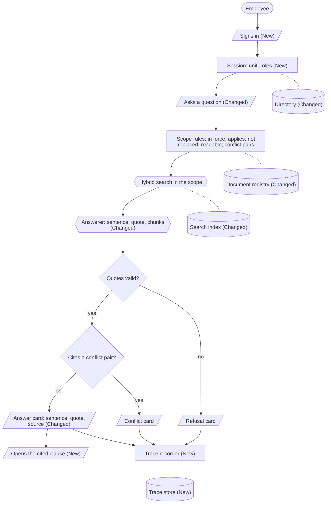
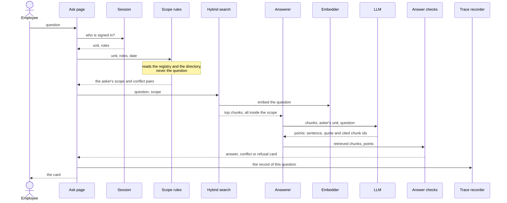
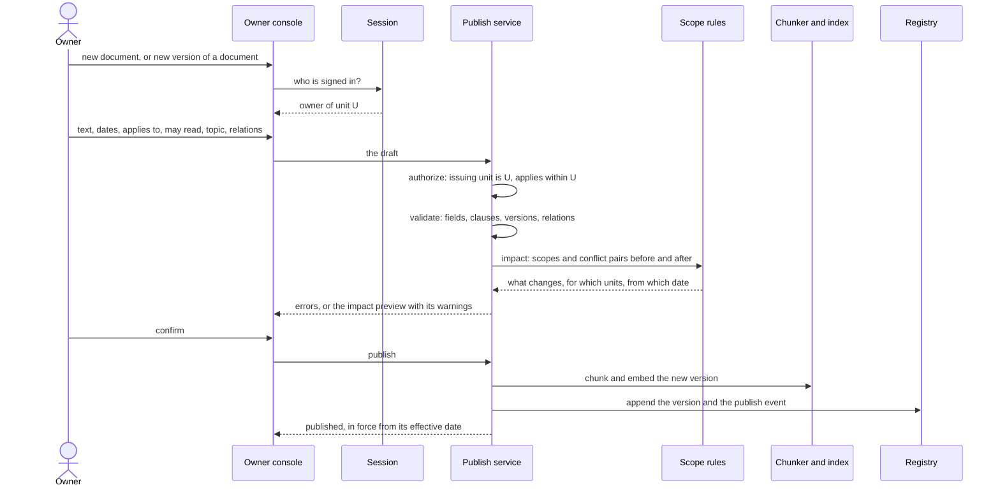
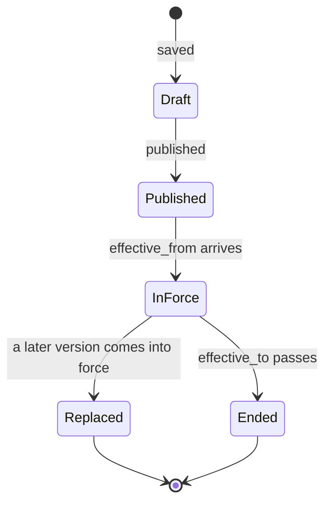
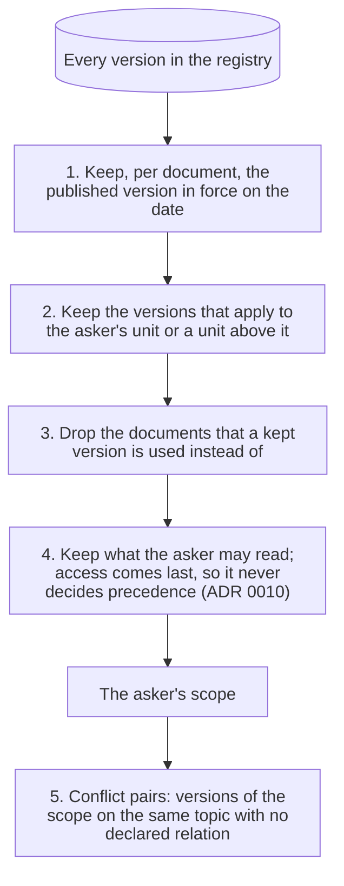
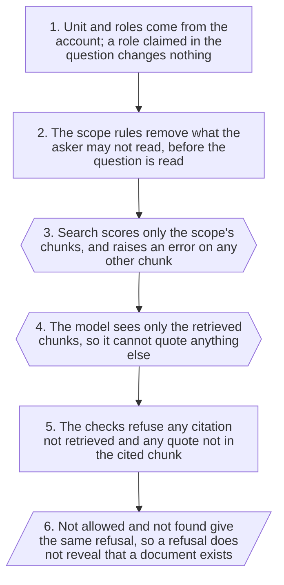

# System design - Tri thức nội bộ Appota

Status: draft by Claude (Opus 5.5), 20/10/2026, for Hiep to review.
Items marked **[to decide]** are open; every option marked "proposed" is Claude's proposal, not a decision.
All Appota data in this project is simulated ("giả lập").

## Contents

| Section | What it covers |
|---|---|
| [1. Scope](#1-scope) | What this design covers, and where the requirements are |
| [2. High-level design](#2-high-level-design) | One flowchart per workflow: employee and document owner |
| [3. Main flows](#3-main-flows) | The same workflows as sequences of calls between components |
| [4. Documents and versions](#4-documents-and-versions) | The terms, the information an owner sets, the checks when publishing, the life of a version |
| [5. Scope rules](#5-scope-rules) | The rules that decide which documents an asker may use |
| [6. Search, answer and checks](#6-search-answer-and-checks) | Chunking, search, the model call, the checks and the cards |
| [7. Owner side](#7-owner-side) | The owner console, declaring relations, the impact preview, correcting mistakes |
| [8. Identity and authorization](#8-identity-and-authorization) | Accounts, sign-in, who may do what, the as-of date |
| [9. Storage and persistence](#9-storage-and-persistence) | What is stored, where, and how it survives a restart |
| [10. Traceability and observability](#10-traceability-and-observability) | The record of each answer, logs, explaining a wrong answer |
| [11. Security and privacy](#11-security-and-privacy) | How nothing outside the asker's rights gets out, and the new surfaces |
| [12. Failure modes and limitations](#12-failure-modes-and-limitations) | What can still go wrong, where this design stands on each known limitation, and the errors the user sees |
| [13. Deployment and operations](#13-deployment-and-operations) | Host, process, models, limits, secrets, configuration, start-up and restart |
| [14. Evaluation](#14-evaluation) | How each metric of the spec is measured |
| [15. Decisions](#15-decisions) | The ADRs this design relies on, and the decisions and questions still open |
| [16. Change readiness](#16-change-readiness) | Where a likely change lands, and what stays |
| [Appendix A](#appendix-a-requirements-traceability) | Each requirement, the components and sections that meet it, and its test |

## 1. Scope

[`mvp_spec.md`](mvp_spec.md) is the source of truth for what the MVP must do: its users, its requirements E1-E8, H1-H5 and S1-S5, its constraints, assumptions and metrics.
This document describes how the system is built to meet them; it cites them by ID and does not restate them.
How v1 answers one question step by step is in [`architecture.md`](architecture.md), what v1 simplifies and defers is in [`scope.md`](scope.md), and why each choice was made is in [`decisions/`](decisions/README.md).

In scope, from the spec:

- An employee asks a question and gets an answer, a conflict notice or a refusal (spec 3.1).
- A document owner publishes documents and versions, declares relations and sees the state of the unit's documents (spec 3.2).
- The system keeps what was published, records every answer and runs in a browser in Vietnamese (spec 3.3).
- The evaluation of spec section 6, for both test questions and owner scenarios.

Out of scope: everything listed under "Deferred" in [`scope.md`](scope.md), such as real single sign-on, DOCX and PDF documents, multi-turn conversation and "Báo sai".
The inputs and their form are fixed by spec section 4; the assumptions A1-A4 of spec section 5 hold throughout.

The expected size is the size of the simulated data: tens of documents, a handful of simulated accounts and one server process.
No number in this document is a measurement unless it names its source.

A choice with real alternatives is shown as **[to decide]** with its options; it is decided by Hiep, through a research issue when it needs one, and recorded in an ADR.
This document never gives the reasons for a decision on Hiep's behalf.

## 2. High-level design

The system has two workflows, one per kind of user.
The employee's and the owner's workflows meet only in the document registry and the search index: the owner's workflow writes them, and the employee's workflow only reads them.

### 2.1 How to read the diagrams

The diagrams use shapes, not colour, to show what each step is.

| Shape | Means |
|---|---|
| Pill | A person |
| Parallelogram | What a person enters or sees on a page |
| Rectangle | A step done by deterministic rules or plain code, with no AI |
| Hexagon | A step that calls an AI model |
| Diamond | A decision taken by rules |
| Cylinder | A store; the same store can be drawn twice to keep lines short |

A solid arrow leads to the next step; a dotted line joins a step to a store it reads or writes.
"(New)" marks a step that v1 does not have, and "(Changed)" a step that v1 has but this design changes; a step with no marker is built in v1 and unchanged.

### 2.2 Employee: asking a question



- The unit and roles come from the account, never from the question.
- The scope rules never read the question, so every question the same asker asks on the same date gets the same scope.
- The answerer writes, for each point, one sentence in plain Vietnamese, the clause it rests on quoted word for word, and the chunks it cites; it never chooses between clauses that disagree (section 6.3).
- The whole answer is refused if a citation was not retrieved or a quote is not in the chunk it cites (section 6.4).
- The answer card shows each sentence above its verified quote, then the document, Điều and effective date; the conflict and refusal cards keep their fixed wording and send the employee to HR.
- Conflicts come from declared metadata, and the model may add one it reads in the text, never remove one (ADR 0014); a content conflict the model does not notice still gives an answer card (section 12.1).
- Each source line of the answer card and each quote of the conflict card links to the cited version, which opens only if it is in the asker's scope on that date (section 6.5).
- The order of the rules inside the scope rules is described in [`architecture.md`](architecture.md#the-7-steps).

### 2.3 Document owner: publishing and checking documents


- An owner may publish only for the unit they own, with `applies_to` that unit or a unit below it (H5).
- The impact preview uses the same scope rules as the employee's workflow, so it shows what employees will actually get.
- The new version is embedded before it is saved, so the registry never names a chunk the index does not have (proposed; section 12.2).
- Nothing runs on the effective date: which version is in force is computed for each question (section 4.4).

## 3. Main flows

### 3.1 An employee asks a question



- The question first enters at search; everything before that is the same for every question the same asker asks on the same date.

### 3.2 An owner publishes a document or a new version



- Errors block publishing; warnings are shown and the owner decides (section 7.3).
- Saving a draft runs the same checks except the impact preview, and never reaches employees.

## 4. Documents and versions

### 4.1 Terms

| Term | Meaning |
|---|---|
| Document | One policy across all its editions, issued by one unit, such as "Quy chế nghỉ phép GameCo", which has versions 1 to 3 and a draft of version 4 in the simulated data; the owner works with documents. In the data it is the `series` field. |
| Version | One edition of a document, with its own text, dates, `applies_to` and `access`; what v1 calls a document. |
| Clause | One "Điều" of a version, or one line of a version without "Điều"; it is what search finds and what a card quotes. In the code it is a chunk. |
| Relation | A version declares that it is used instead of ("dùng thay") or adds to ("bổ sung") another document. |

### 4.2 The information an owner sets for each document

This section answers the first open question of the spec (section 4): the exact list.
The list below is v1's metadata plus the fields publishing needs; it is a proposal **[to decide]**.

| Field | Meaning | Set by | v1 |
|---|---|---|---|
| `id` | The version's identifier | The system, from the document and a version number (proposed) | Typed by hand |
| `series` | The document the version belongs to | The system: a new document, or the document the owner chose to add a version to | Typed by hand |
| `title` | The title shown on the card | Owner | Same |
| `issuer` | The unit that issues the document | The system: the owner's unit (proposed) | Not a field; `owner` holds the HR contact's name |
| `topic` | One subject from a fixed list, used only to find conflict pairs | Owner, from the list **[to decide: who maintains the list]** | Same, free text |
| `status` | `draft` or `published` | Owner, by saving or publishing | Same |
| `effective_from` | The first day it is in force | Owner | Same |
| `effective_to` | The last day, only when the rule really ends | Owner, optional | Same |
| `applies_to` | The unit it applies to, with every unit below it | Owner, within the owner's unit | Same |
| `access` | Who may read it: all staff, one unit, or some roles; never who it is for (ADR 0010) | Owner | Same |
| `overrides` | The documents it is used instead of, for the units it applies to ("dùng thay") | Owner | Same |
| `complements` | The documents it adds to without contradicting them ("bổ sung") | Owner | Same |
| `published_by`, `published_at` | Who published it, and when | The system | New |
| Body | Markdown text, each clause on its own line starting with "Điều n." | Owner | Same |

### 4.3 Checks when publishing

**Errors** stop the publish; the first group already stops v1's start-up (`integrations/data_files.py`, `services/chunking.py`).

| Check | v1 |
|---|---|
| `status` is `draft` or `published`; `access` has a known form | Built |
| `effective_to` is not before `effective_from` | Built |
| No two published versions of a document start on the same day | Built |
| `overrides` does not name its own document, and no chain of overrides forms a cycle | Built |
| `overrides` and `complements` name documents that exist | Built |
| The body does not mix "Điều" lines with plain lines, and repeats no "Điều" number | Built |
| The issuing unit is the owner's unit, and `applies_to` is that unit or a unit below it (H5) | New |
| The roles and units in `access` exist | New |
| A published version may not start before today **[to decide]**; otherwise a publish rewrites what employees were told in the past | New |
| `overrides` may name only a document of a unit above the issuing unit **[to decide]** | New |

**Warnings** are shown in the impact preview, and the owner decides:

| Warning | What employees get if the owner publishes anyway |
|---|---|
| A new conflict pair: a document on the same topic applies to some of the same units, and no relation is declared | The employees of those units get the conflict card |
| A new version that fewer people may read than the version it replaces | The employees who lose access get a refusal, not the older rule (ADR 0010) |
| A version that replaces another document | Every clause of that document is gone for the units it applies to ([#24](https://github.com/Park-Hip/next-gen-2026/issues/24)) |

### 4.4 The life of a version



Only "draft" and "published" are stored.
"Published but not yet in force", "in force", "replaced" and "ended" are computed from the dates of the document's versions and the date asked, so no job has to change them on the day.
The version was indexed when it was published, so the new rule reaches employees from its effective date and not before (H3).
How a mistake in a published version is corrected is open (section 7.4).

## 5. Scope rules

The rules are built and tested; [`architecture.md`](architecture.md#who-decides-what) gives each rule, its code and what happens when it goes wrong.
For one account and one date, they narrow every version down to the asker's scope:



The full design changes the rules' inputs and callers, not the rules:

| | v1 | Full design |
|---|---|---|
| Documents | `data/documents/` | The registry |
| Unit and roles | The persona picker | The session |
| Callers | The ask page, the evaluation and the "Dữ liệu giả lập" page | Also the publish service for the impact preview, and the owner console for each version's state, so there is one definition of "in force" and "applies" (proposed) |

## 6. Search, answer and checks

### 6.1 Chunking and the index

- One chunk per "Điều", or per line for a document without "Điều"; a chunk's id is the version id and its number (`LEAVE-GAMECO-v2#2`).
- The text indexed is the document title followed by the chunk, for both BM25 and embeddings.
- The index holds every chunk of every version, including drafts, future and replaced versions; the scope is applied at search time, so a version needs no re-indexing when it comes into force.
- Changed: v1 embeds everything at start-up; in the full design, publishing adds the new version's chunks (section 3.2).

### 6.2 Search

- BM25 over Vietnamese syllables, with its statistics computed over the asker's scope only, and cosine similarity over `gemini-embedding-001`, fused by reciprocal rank fusion (ADRs 0001, 0002).
- The top 5 chunks go to the answerer (`retrieval.top_k` in `config.yaml`).
- Only chunks of the asker's scope are scored, and a final check raises `ScopeLeakError` on any other chunk.

### 6.3 The answerer

One call to `gemini-3.5-flash-lite` at medium thinking (ADR 0008), with no sampling and with structured output.
The model sees only the retrieved chunks, the asker's unit and the question.

Changed: it returns a list of points, or no points.
Each point is one sentence in plain Vietnamese that answers part of the question (`claim`), the passage it rests on copied word for word (`quote`), and the retrieved chunk ids it cites, from an enumerated list (ADR 0003; v1 has no `claim` since ADR 0009, which a new ADR supersedes).
For example, for a GameCo employee who asks how many days of annual leave they get, with the simulated document `LEAVE-GAMECO-v2`:

```json
{"points": [{
  "claim": "Bạn được nghỉ phép năm 14 ngày mỗi năm.",
  "quote": "Nhân sự GameCo được nghỉ phép năm 14 ngày mỗi năm.",
  "chunks": ["LEAVE-GAMECO-v2#2"]
}]}
```

Changed: the prompt adds these rules.

1. Write the sentence in plain Vietnamese and keep every condition its quote names, such as "chính thức".
2. Make one point per document's clause, so each sentence rests on one quote.
3. When clauses from different documents give different answers, make one point for each, and do not choose between them, merge them or decide which one applies.
4. Do not return no points only because clauses disagree.
5. State only values the text states; do not compute a date or an amount from them, so applied questions stay a limitation ([#51](https://github.com/Park-Hip/next-gen-2026/issues/51)).
6. If the question asks for a value about the employee's own record that no clause states, such as how many leave days are left, return no points; a general yearly entitlement is not that value.
7. When two clauses from different documents give different answers, list the ids of those two chunks in `disagreement` (ADR 0014); both must also be cited by a point.

The prompt never says which documents form a conflict pair: the rules decide the card, and the flag is only an input that step 7 checks.

### 6.4 The checks and the card

The rules pick the card from the citations, never from the model's words, in this order:

| Card | When | Shows |
|---|---|---|
| Refusal | The output is malformed, has no points, has a point with no citation, cites a chunk that was not retrieved, or quotes text that is not in a chunk it cites, after Unicode and whitespace folding | Fixed text that sends the employee to HR; "not allowed" and "not found" read the same (E4) |
| Conflict | A cited document is in a conflict pair, or the model's `disagreement` names two chunks that pass step 7's checks (ADR 0014) | One clause per side, chosen without reading meaning, and fixed text that sends the employee to HR (ADR 0005); never the model's sentences |
| Answer | Otherwise | Changed: for each point, the model's sentence on top and the verified quote under it in quotation marks; then the document, the "Điều", the effective date and the HR contact (E7; SD14, decided by Hiep on 20/10/2026) |

Every card starts with who the asker is asking as.
Every answer card then has one fixed line saying that the bold sentence is the system's paraphrase and the quoted text is the checked wording of the rule (#77, G5.4); the conflict and refusal cards show no model text and do not have it.
The sentence is not checked at run time, by rules or by a second model call (SD14); the employee reads it above its quote, and the evaluation reads it against its quote (section 14).

### 6.5 Reading the cited part (E7)

The spec asks that the employee "can read that part".
v1 shows the quote, which can be only part of a clause.
Built in #77 (SD10, decided by Hiep on 21/10/2026): each source line of the answer card, and each quote of the conflict card, links to a page for the version that was cited.
The page shows the whole version, with the cited "Điều" (or, for a document without "Điều", the cited line) highlighted and scrolled to, under its title, its validity window and the notice of a coming change, who it applies to and the HR contact.
The link carries the chunk ids and the card's as-of date, plus the account asked as for the judge only; it never decides who an employee is.
The server rebuilds the signed-in asker's scope on that date and opens the page only if every chunk is in it and all belong to one document.
A chunk outside the scope, an unknown id, a bad date and an unknown path all give the same 404 page, so the link cannot be used to read another document or to learn that one exists (section 11).
The page calls no model and no embedder.

### 6.6 The demo cache

An in-process cache of the last 256 replies, keyed by the account, the scope's chunk ids and the question, so a scope that changes with the date never reuses an old answer; the checks still run on every hit, and the evaluation never uses it.
v1 keys by the persona id.

## 7. Owner side

All of this section is **New**.
It covers H1-H5; approval workflows, notifications and periodic review stay deferred ([`scope.md`](scope.md#owners-and-workflow)).
An owner owns exactly one unit, and may publish and see only that unit's documents (H5); whether they also see the units below it is SD9.

### 7.1 The owner console

| Page | Shows or does | Requirement |
|---|---|---|
| The unit's documents | Each document with its versions, each version's state today, its dates, who it applies to, who may read it and its relations | H4 |
| One version | The full text, its metadata and its publish events | H4, S4 |
| Publish | The form of section 7.2, then the impact preview, then confirm | H1, H2 |
| Drafts | Saved drafts, which employees never see | H1 |

Each version's state comes from the same rule function that decides validity for employees, so the console cannot disagree with what employees are told (proposed).
In v1, the "Dữ liệu giả lập" page computes these states in `services/guide.py`, separately from the rules.

### 7.2 Declaring relations (H2)

The owner should not have to know other units' document ids.
Proposed: when the owner picks a topic and the units the document applies to, the form lists the documents of other units on the same topic that also apply to some of those units, and for each one the owner chooses:

| Choice | Meaning | Employees of those units get |
|---|---|---|
| **Dùng thay** | This document replaces the other one for the units it applies to | This document only |
| **Bổ sung** | This document adds to the other one without contradicting it | Both documents |
| **Not declared** | - | The conflict card, and the preview says so |

The list is built by the scope rules from metadata only; no AI suggests a relation, an idea [`scope.md`](scope.md#owners-and-workflow) keeps deferred.

### 7.3 The impact preview

Before confirming, the owner sees, for each unit the document applies to, on today's date and on its effective date:

- which documents employees of that unit will use, and which ones leave their scope;
- the new conflict pairs;
- the warnings of section 4.3.

The preview shows only documents the owner may read, so it cannot reveal another unit's restricted document (proposed).
It partly mitigates [#50](https://github.com/Park-Hip/next-gen-2026/issues/50): a wrong topic or a wrong relation becomes visible before employees see it, but nothing proves the owner reads it.

### 7.4 Correcting a mistake **[to decide]**

| Option | Publish a new version | Withdraw a version not yet in force | Withdraw a version in force |
|---|---|---|---|
| a) | Yes | No | No |
| b) | Yes | Yes | No |
| c) | Yes | Yes | Yes |

Withdrawing keeps the version's record but removes it from the rules; with a new version only, the wrong version stays in force until the new one starts.

Whatever is chosen, the record of what was published and when is never deleted (S4).

## 8. Identity and authorization

### 8.1 Accounts

A simulated account has an id, a name, a unit and a set of roles; owner accounts add the unit they own (proposed).
v1 keeps the accounts in `data/personas.yaml`: Minh, Lan, Hà and Hoa (HR GameCo, role `hr_gameco`) are employees, and `Giám khảo` (role `evaluator`) is the judge, who is not an employee.
One owner account per unit that issues documents is proposed for the owner console.

### 8.2 Sign-in

**Decided by Hiep, 21/10/2026 (ADR 0016):** the user picks an account and types a password shared by every simulated account; the shared password is published in the README, because the accounts and data are simulated.

| Option | How | Status |
|---|---|---|
| a) Pick an account | A sign-in page lists the simulated accounts; the user picks one, and the server keeps the account id in a signed session cookie | Not chosen: no password at all |
| b) Password | A password is typed with the account | **Chosen**, as one demo password shared by every account, read from `DEMO_PASSWORD`; the cookie holds only the account id and is signed with `SESSION_SECRET` |
| c) Single sign-on | The company's real sign-in | Deferred ([`scope.md`](scope.md#simplified)) |

In a and b the server reads the unit and roles from the account, never from the request or the question, which is what E8 requires.
A `persona` in the URL or the form is ignored for an employee.

### 8.3 Who may do what

Every check runs on the server for every request; hiding a button is not a check.

| Action | Employee | Owner of unit U | Evaluator |
|---|---|---|---|
| Ask a question | Yes | Yes, as an employee of their own unit | Yes, as any employee account it chooses on the ask page, and through the evaluation harness |
| Open a cited clause | Only a chunk in their scope on that date | Same | Same |
| See unit U's documents and their state | No | Yes | **[to decide]** |
| Publish or save a draft for U | No | Yes | No |
| See the "Dữ liệu giả lập" page | No (404) | No (404) | Yes |
| See the "Tình huống kiểm thử" page | No (404) | No (404) | Yes |
| Pick the as-of date | Yes, labelled as a demo control | Yes, labelled as a demo control | Yes, labelled as a demo control |

In production the date is always today in Vietnam; v1 lets the user pick it so that judges can see a version change without waiting for it, and says so next to the picker.
The "Dữ liệu giả lập" page lists every document with its title, including restricted ones such as "Khung bậc lương GameCo".
That is right for judges looking at simulated data, but it would break E4, which forbids even showing a document's title, so only the judge account opens it; every other account gets a 404 (ADR 0016).

## 9. Storage and persistence

### 9.1 What is stored

| Data | Written by | Read by | Survives a restart |
|---|---|---|---|
| Versions, their text and metadata, publish events | Publish service | Scope rules, owner console, data page | Required (S4) |
| Org tree and accounts | Nobody at run time: loaded from `data/` | Session, scope rules, cards | From the repository |
| Search index | Start-up and publish service | Search | Can be rebuilt from the versions |
| Traces | Trace recorder | Evaluator | Required (S3) |
| Evaluation runs | Evaluation harness | Report, test-case page | Committed to the repository, as in v1 |

### 9.2 Where it is stored **[to decide]**

The requirement that published documents survive a restart conflicts with today's host: by ADR 0004, a Render free web service loses its local files on every spin-down, restart or redeploy.
This needs a research issue and an ADR.
Options to research; none of their limits or prices has been checked for this document:

| Option | Changes host | Note |
|---|---|---|
| a) A hosted Postgres database, such as Neon, Supabase or Render Postgres | No | The options ADR 0004 listed for "Báo sai" records; possibly with pgvector to keep the embeddings too |
| b) A SQLite file on a host with a persistent disk | Yes | |
| c) Published documents committed to the GitHub repository through its API | No | |
| d) Keep files and accept the loss | No | Fails S4 and the restart scenario |

The choice also decides whether embeddings are stored or recomputed at start-up (SD2).
Two publishes at the same time are kept apart by a single lock, since there is one process (proposed).

## 10. Traceability and observability

### 10.1 The trace record (S3)

Proposed: the page writes one record per question in the same shape the evaluation already writes in `results/*.jsonl`, so the same scoring and reading tools work on both.

| Fields | Evaluation record | Page record |
|---|---|---|
| Run id, date, question, status and error, commit | Yes | Yes |
| The asker | Persona id | Account id (New) |
| Model, thinking level, embedding model, top k | Yes | Yes |
| The scope's documents, conflict pairs and chunks | Yes | Yes |
| Retrieved chunks and their text | Yes | Yes |
| Raw model reply, points, card, latency | Yes | Yes |
| Each point's sentence | New | New |
| Trace id | - | New |
| Whether the cache answered | - | New |

Open **[to decide]**:

- Whether the card shows the trace id, so an employee can quote it to HR.
- How long traces are kept; the questions are simulated now, but a real question can be personal.

### 10.2 Logs

v1 writes one JSON log line per search, per model answer and per page request on standard output; the design keeps them for operating the server, and the trace store becomes the record that S3 relies on.

### 10.3 Explaining a wrong answer

From a trace, the evaluator sees which documents the rules kept, which chunks search returned, what the model replied and which check decided the card, without calling any model.
Rescoring a saved run without calling the API already works for the evaluation (ADR 0006).

## 11. Security and privacy

### 11.1 How nothing outside the asker's rights gets out (E4, E8)

A document the asker may not read has to get past six safeguards in a row to reach them:



Tests already check that no restricted chunk reaches any asker's scope for every asker, every boundary date and every test question, and with seven trap edits to the data (`tests/services/test_scope.py`).

### 11.2 New surfaces this design adds

| Surface | Risk | Control |
|---|---|---|
| The cited-clause link | Opening a chunk id of another document | The server checks the chunk is in the asker's scope for that date (section 6.5) |
| The owner console | Reading or publishing for another unit | Server-side check of the owned unit on every request (section 8.3) |
| The impact preview | Showing another unit's restricted document | The preview shows only what the owner may read (section 7.3) |
| The data and test-case pages | Showing restricted titles to employees | Only the judge account opens them; any other account gets a 404 (section 8.3) |
| The session cookie | A forged account | Signed with `SESSION_SECRET` from the environment; it holds only the account id, and a tampered or wrongly signed cookie is treated as signed out |
| Document text written by owners | Instructions to the model inside a document | The model can only cite and quote retrieved chunks, and its sentence is not checked; at worst it gives a refusal, or a misleading sentence above a real quote |

## 12. Failure modes and limitations

### 12.1 Failures that look like right answers

The failures that look like right answers matter most, because the employee cannot tell them from a right answer; the safe ones send the employee to HR.

| Failure | Looks like | Caught by | In this design |
|---|---|---|---|
| The model quotes a real clause in scope that does not answer the question | A right answer | Hiep's reading in the evaluation; the employee reads the quote and its source | Unchanged |
| The sentence changes a number, drops a condition of its quote, adds a fact, or applies the clause to the wrong people | A right answer | The quote under the sentence; Hiep's Faithfulness reading (section 14) | New with the sentence; a check on the sentence stays possible (section 16) |
| Two documents state the same fact differently, and the owner side did not catch it: a wrong topic, a wrong "bổ sung", or different topics | A right answer, from one side; or an answer card with both sides | The model's flag, when it notices both sides (ADR 0014); the evaluation; a list of answers that cite documents with no declared relation, for owners to review (SD16) | Mitigated at question time; a miss stays a limitation; the publish-time scan is SD15 |
| An owner sets wrong metadata, such as a wrong topic or a wrong relation ([#50](https://github.com/Park-Hip/next-gen-2026/issues/50)) | A right answer | Nothing in v1 | Partly mitigated by the relation list and the impact preview (sections 7.2, 7.3) |
| A question about another period gets the rule in force on the date asked ([#53](https://github.com/Park-Hip/next-gen-2026/issues/53)) | A right answer | The evaluation | Unchanged; see section 16 |
| A company replaces only one clause of a Group policy, and the whole Group policy drops out ([#24](https://github.com/Park-Hip/next-gen-2026/issues/24)) | A refusal | The evaluation | A warning in the impact preview (section 4.3); clause-level relations stay deferred |
| Two policies in a conflict pair agree on the point asked, and the employee still gets the conflict card ([#52](https://github.com/Park-Hip/next-gen-2026/issues/52)) | A conflict notice | The evaluation | Unchanged |
| A question that needs a clause applied to a case is refused although the clause was found ([#51](https://github.com/Park-Hip/next-gen-2026/issues/51)) | A refusal | The evaluation | Unchanged |
| The registry or the host loses published documents | Answers from the old rules | The restart scenario | Depends on section 9.2 |

Each of the five issues stays open with the `limitation` label until it is fixed; the undetected content conflict needs its own `limitation` issue, to open.

### 12.2 Errors the user sees

These failures stop the answer or the publish and say so, so nobody acts on a wrong answer.

| Failure | What happens | Status |
|---|---|---|
| The LLM or the embedder fails after retries, or its rate limit is reached | The page shows "Hệ thống tạm thời không trả lời được..." and no card; the trace records the error | Built (trace New) |
| Search returns a chunk outside the scope | `ScopeLeakError`; no card | Built |
| A chunk of the scope is missing from the index | Search raises an error naming the chunk; no card | Built |
| The model's output is malformed, cites nothing, cites outside what was retrieved, or quotes text not in the cited chunk | Refusal card | Built |
| A publish fails validation | Nothing is saved; the console shows the errors | New |
| Indexing fails during a publish | Nothing is saved; the owner retries (proposed: index first, then save) | New |
| The registry is unreachable | Error page for questions and publishing; never an answer from stale data (proposed) | New |

## 13. Deployment and operations

### 13.1 What runs where

| Area | Today | Source |
|---|---|---|
| Host | A Render free web service in Singapore, auto-deploying from a Blueprint; it sleeps after 15 idle minutes and wakes in about a minute | ADR 0004 |
| Process | One uvicorn process; the index and the model clients are built at start-up, so invalid data or a missing key fails the health check | `main.py` |
| Models | `gemini-3.5-flash-lite` at medium thinking, `gemini-embedding-001` | `config.yaml`; ADRs 0002, 0008 |
| Limits | 12 requests a minute, 80% of the free-tier limit; 6 retries; 30 seconds per attempt; questions up to 300 characters | `config.yaml`; ADR 0008 |
| Secrets | `GEMINI_API_KEY`, set only in the Render dashboard | ADR 0004 |
| Configuration | Every tunable value in `config.yaml`, read only through `core/config.py` | AGENTS.md |

The full design adds a session secret and, depending on section 9.2, a database URL, both from the environment.
New `config.yaml` keys are added by the change whose code first reads them.

### 13.2 Start-up and restart

1. Load `config.yaml` through `core/config.py`.
2. Connect to the registry; if it is empty, load the simulated documents of `data/documents/` into it once (proposed).
3. Load the directory from `data/org.yaml` and the accounts file.
4. Build or load the search index **[to decide]**: v1 embeds every chunk at start-up; a persistent store could keep the vectors (section 9).
5. Load the committed evaluation run for the test-case page.

Any invalid data stops the start-up, so the deploy fails its health check instead of serving wrong answers, as in v1.
A restart must keep every published document and its history (S4, Owner scenarios).

## 14. Evaluation

The evaluator is Hiep when building, and the judges when looking at the demo.
Test questions go through the employee's workflow unchanged and with no cache, so the evaluation tests what employees get.

How each metric of spec section 6.2 is measured:

| Metric | How | Status |
|---|---|---|
| Right sources and right kind | Each test question's scope and card compared with its expected documents and kind; gate "Rules correct in every case" | Built |
| Leaks | Gate "Leaks", plus the exhaustive scope test of section 11.1 | Built |
| Unsafe answers | Gates on the card and on the raw model reply, confirmed by hand (ADR 0006) | Built |
| Faithfulness | Hiep reads every answer, each sentence against its quote, in a review file next to the run, and names the error of an unfaithful sentence: a changed number, a dropped condition, an added fact, a flipped meaning, or the wrong people | Changed: v1 cards have quotes only |
| Over-caution | At most 10% of the questions that expect an answer (`eval.over_cautious_max_share`); rechecked after the prompt change of section 6.3 | Built |
| Readability | Read by a person, on the answer card's sentences; the criterion is open in the spec | **[to decide]** |
| Source shown | Each answer card names the document, the part, the version and its date, and the part can be opened | Changed: the card already names them; opening the part is section 6.5; whether this is checked automatically today is to be checked |
| Traceable answers | Every question has a trace with its scope, retrieved chunks and reply | New: v1 has this for evaluation runs only |
| Owner scenarios | Automated tests on fake models: publish, then ask before and on the effective date; publish for another unit and be stopped; see the state; restart and ask again | New |

Owner scenarios need no LLM to decide pass or fail, because the scope rules decide which documents an answer may use; they can run in `python -m pytest` with the fake embedder and the fake model the tests already use.

## 15. Decisions

### 15.1 Decisions already made

The ADRs in [`decisions/`](decisions/README.md) hold for the full design; the ones it relies on most are:

| ADR | Decides | In this design |
|---|---|---|
| 0001, 0002 | Search on LangChain core, with our own Vietnamese BM25, `gemini-embedding-001` and RRF | Holds |
| 0003, 0008 | One model call that cites retrieved ids and quotes | Holds; the prompt changes (section 6.3) |
| 0004 | The host, and leaving "Báo sai" and the owners' page out of Mission 2 | The owner console reverses the second part and needs a new ADR |
| 0005 | The conflict card | Holds |
| 0009 | The card shows only the verified quote | Superseded by 0011: the card shows the sentence above the verified quote (section 6.4) |
| 0010 | Access is checked last | Holds |

### 15.2 Decisions this design needs

| # | Decision | Options | Needs research | Section |
|---|---|---|---|---|
| SD1 | Where published documents and traces are stored, and on which host | Section 9.2 a-d | Yes | 9.2 |
| SD2 | Whether embeddings are stored or recomputed at start-up | Store; recompute | With SD1 | 9.2, 13.2 |
| SD3 | How a user signs in | Section 8.2 a-c | **Decided by Hiep, 21/10/2026**: pick an account and type one shared demo password, published in the README; ADR 0016 | 8.2 |
| SD4 | The information an owner sets for each document | Section 4.2 | No | 4.2 |
| SD5 | Who maintains the list of topics | Owners; one central owner; a fixed list in the data | No | 4.2 |
| SD6 | Whether a published version may start before today | Allow; refuse | No | 4.3 |
| SD7 | Which documents `overrides` may name | Any; only a document of a unit above | No | 4.3 |
| SD8 | How a mistake in a published version is corrected | Section 7.4 a-c | No | 7.4 |
| SD9 | Whether an owner also sees and publishes for units below their unit | Own unit only; own unit and below | No | 7 |
| SD10 | Whether the card links to the full cited clause | Link; quote only | **Decided by Hiep, 21/10/2026** (#77): the link opens the whole cited version with the cited "Điều" or line highlighted, for the answer and the conflict card | 6.5 |
| SD11 | Who sees the data and test-case pages, and the date picker | Everyone; evaluator only | **Decided by Hiep, 21/10/2026**: the evaluator account only, others get a 404; the date picker stays, labelled as a demo control; ADR 0016 | 8.3 |
| SD12 | Whether the card shows a trace id, and how long traces are kept | - | No | 10.1 |
| SD13 | Whether the HR contact receives unanswered questions or is only named: the spec's Users table says they receive them, but no requirement covers it, and E6 only names who to ask | Add a requirement and a way to forward questions; change the Users row to say the HR contact is named | No | - |
| SD14 | Whether the answer card keeps showing only the verified quote, or also a sentence the model words | **Decided by Hiep, 20/10/2026**: the sentence on top and the verified quote under it; the sentence is not checked at run time; no conflict detection at question time, **changed by ADR 0014**: the model may flag a disagreement, step 7 checks it | ADR 0011, ADR 0014 | 6.3, 6.4 |
| SD15 | Whether a content conflict scan runs when an owner publishes | To discuss with the owner workflow | Yes | 12 |
| SD16 | Whether owners get a list of answers that cite documents with no declared relation between them | To discuss with the owner workflow | No | 12 |
| SD17 | The criterion for Readability (spec section 6.2) | - | No | 14 |

## 16. Change readiness

Where a likely change lands, and what stays as it is.
The rows are candidates from the Mission 1 decisions and the deferred list, not commitments.

| Change | Lands in | Stays |
|---|---|---|
| A person in two units (kiêm nhiệm) | Accounts hold several units; the scope rules run once per unit, or the user picks the unit they ask for | Search, the answerer, the checks |
| A company replaces one clause of a Group policy ([#24](https://github.com/Park-Hip/next-gen-2026/issues/24)) | Relations point at clauses instead of documents; the scope rules drop clauses instead of whole documents | Search, the answerer, the cards |
| Employment type or seniority decides applicability | A new field on versions and accounts, and one more rule in the scope rules | Everything after the scope |
| Questions about another period ([#53](https://github.com/Park-Hip/next-gen-2026/issues/53)) | The user picks the period, never the AI, and the scope rules run on that date | The rules themselves |
| DOCX or PDF documents | A parser in the publish service that produces the same chunks | Everything after chunking |
| A new kind of access rule | `allowed` in the scope rules and the publish checks | The order of the rules (ADR 0010) |
| Real single sign-on | The sign-in component only | The rules need only unit and roles |
| Many more documents | The index moves to a persistent vector store | The rules, the answerer, the checks |
| Another model | `config.yaml` and a new ADR | Everything else |
| A check on each sentence at run time, by rules or by a second model call, if the Faithfulness reading shows that sentences mislead | The answer checks only, with a new ADR | The scope rules, search, the answerer, the cards |
| "Báo sai" and the owners' records | A new record type in the registry's store and a page in the owner console | The answering half |

## Appendix A. Requirements traceability

| Req | Components | Section | Status | Tested by |
|---|---|---|---|---|
| E1 | Ask page, hybrid search, answerer | 3.1 | Changed (6.3, 6.4) | Readability |
| E2 | Scope rules, directory | 3.1 | Built | Right sources and right kind |
| E3 | Scope rules, registry | 3.1, 4.4 | Built | Right sources and right kind |
| E4 | Scope rules, hybrid search, answer checks, card text | 3.1 | Built; new surfaces in 11.2 | Leaks |
| E5 | Scope rules, answer checks | 3.1 | Built | Right sources and right kind |
| E6 | Answer checks, card text, directory | 3.1 | Built | Right sources and right kind; Unsafe answers |
| E7 | Answer checks, card text, ask page | 3.1 | Changed (6.5) | Source shown |
| E8 | Sign-in and session, directory | 3.1 | New | Leaks |
| H1 | Owner console, publish service, registry | 3.2 | New | Owner scenarios |
| H2 | Owner console, publish service | 3.2, 7.2 | New | Owner scenarios |
| H3 | Registry, search index, scope rules | 3.2, 4.4 | Changed (index updated on publish) | Owner scenarios |
| H4 | Owner console, scope rules | 7.1 | New | Owner scenarios |
| H5 | Sign-in and session, publish service | 3.2 | New | Owner scenarios |
| S1 | Answerer, answer checks | 3.1 | Changed (6.4) | Faithfulness |
| S2 | Answer checks, card text | 3.1, 12.2 | Built | Unsafe answers; Over-caution |
| S3 | Trace recorder, trace store | 3.1 | New | Traceable answers |
| S4 | Registry and its store | 3.2, 13.2 | Changed (9.2) | Owner scenarios |
| S5 | Pages | All | Built | Run through the web page |
